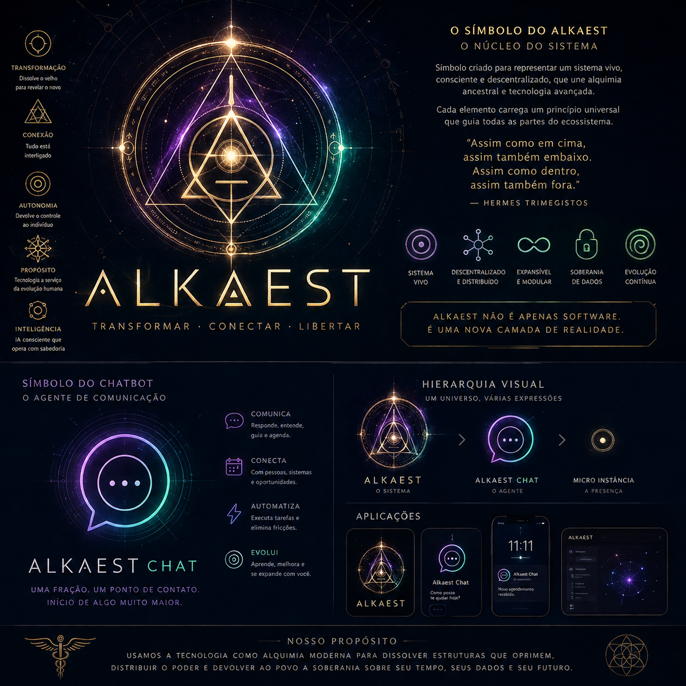
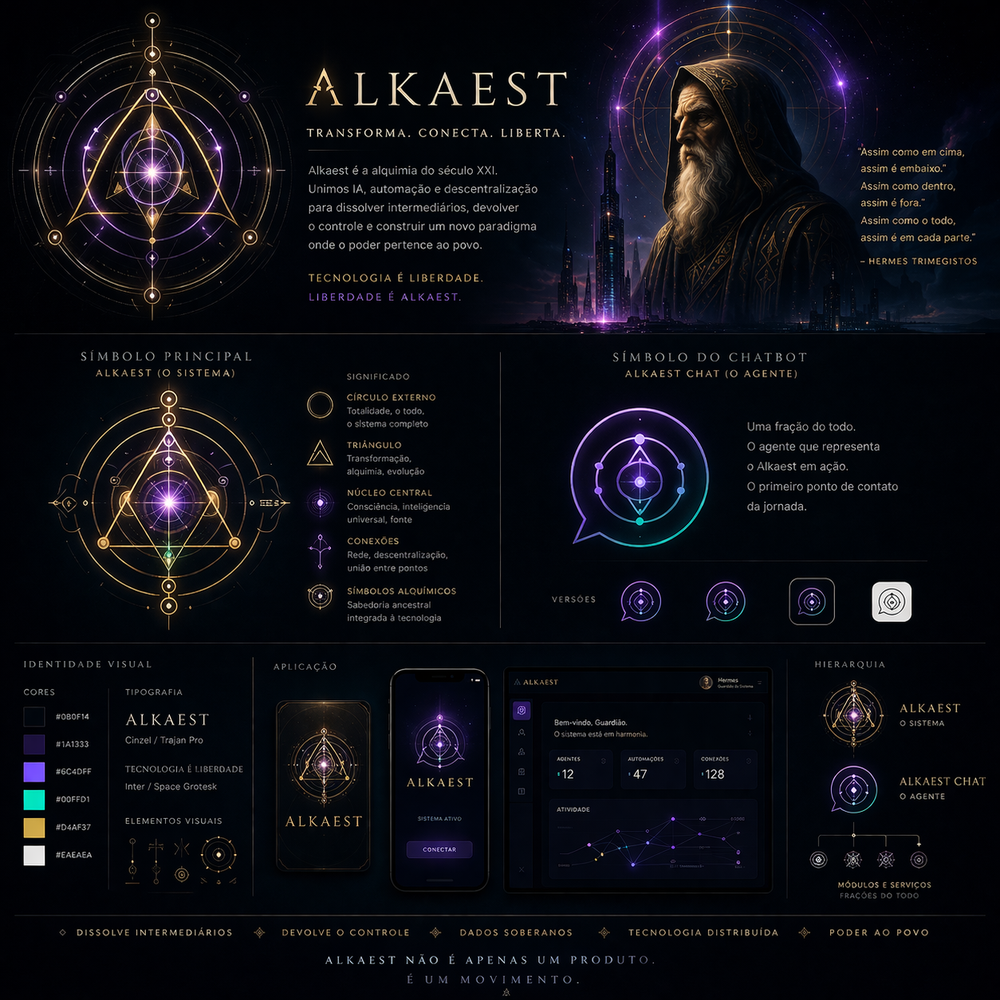

# Alkaest Visual Identity

This guide records the visual references selected for Alkaest. The attached boards are the canonical source for the current visual direction; they are references for design work, not specifications of implemented product behavior.

## Core direction

- **Mood:** dark, calm, precise, and a little alchemical; use cosmic imagery sparingly so interfaces remain legible and grounded.
- **Palette:** near-black/navy foundations, warm gold for the Alkaest system, violet for intelligence and the Chat interface, and restrained teal for connection or activity. The board's sample values are starting points, not a locked token system.
- **Geometry:** circles, orbital paths, triangles, and connected points can suggest transformation, a living system, and decentralization. Keep diagrams purposeful and avoid decorative complexity that competes with content.
- **Typography:** an elegant display serif for the Alkaest wordmark and editorial moments; a clear sans serif for product interfaces and long-form reading.
- **Hierarchy:** Alkaest is the whole system. Alkaest Chat is one agent and one entry point within it. Product UI should make that relationship clear without implying the chatbot is the protocol itself.
- **Accessibility:** preserve contrast, readable type sizes, keyboard focus, and reduced-motion support. Glow and gradients are accents, never the only way to communicate meaning.

## Reference boards

### Alkaest symbol and Chat identity

Use this board for the distinction between the system mark and the Chat agent, and for the visual vocabulary of their symbols.

### Visual system and applications

Use this board for the palette, hierarchy, and broad application direction across web and app surfaces.

## Applying the identity

- Treat these images as visual moodboards. Text embedded in them—including quotations, feature descriptions, and statements about decentralization, sovereignty, or product capability—is not authoritative product copy or a promise that those capabilities already exist.
- Prefer the editable design tokens and component rules in the relevant application over sampling colors from a compressed image.
- Do not place either full board as a background behind functional content. Extract the relevant mark, color, and geometry into the interface.
- Keep the public product focused on what is implemented today; use roadmap and protocol documents for future capabilities.

## Related direction

Audio references and sound-design notes are kept separately in the local, private workspace note. They are not part of the public brand assets or repository.
