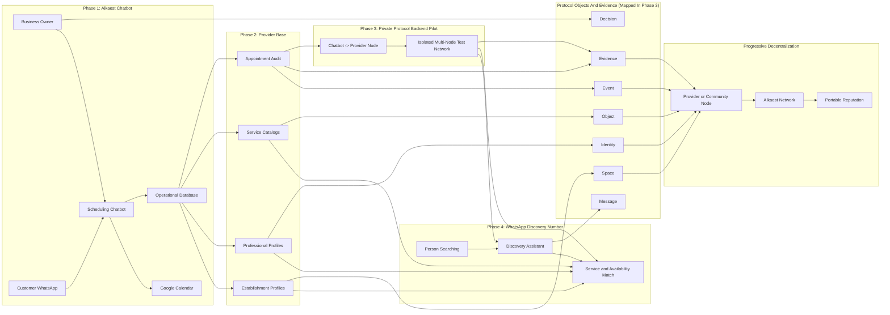

# Chatbot-to-Network Progression

## Notes

This diagram shows product progression, not a commitment that all chatbot data becomes public protocol data.

The protocol backend is validated behind the existing chatbot before the discovery or reputation frontend is exposed. Appointment-derived records must be filtered through privacy, consent, provenance, and minimization rules before becoming network Evidence. Completion, customer feedback, and reputation are separate concepts.

