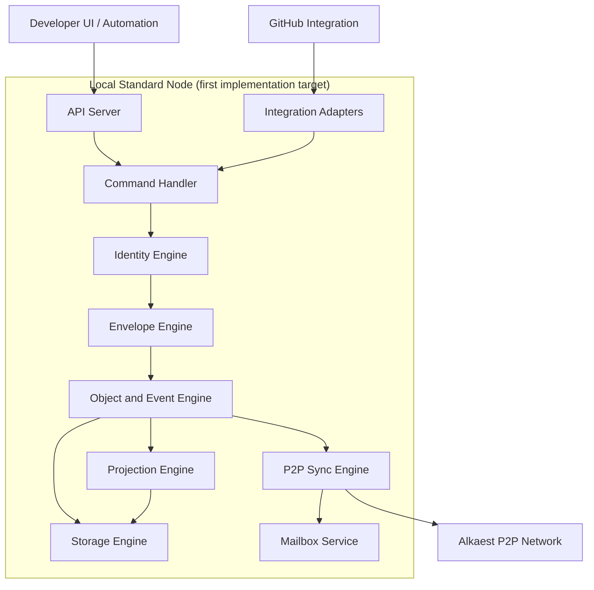

# Node Architecture

## Notes

- This diagram shows the first implementation path. The architecture supports Light, Standard, and Service profiles; see [RFC-0002](../rfc/0002-node-architecture.md) §16 and [ADR-0003](../decisions/ADR-0003-heterogeneous-nodes-and-network-validation.md).
- GitHub is an integration input, not protocol authority.
