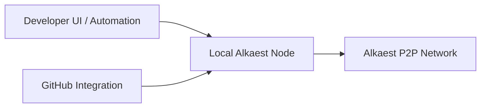
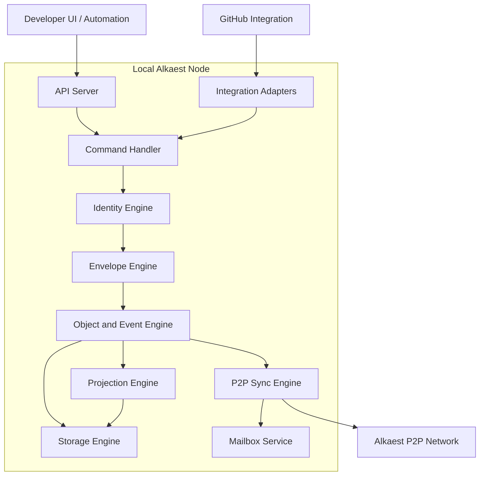
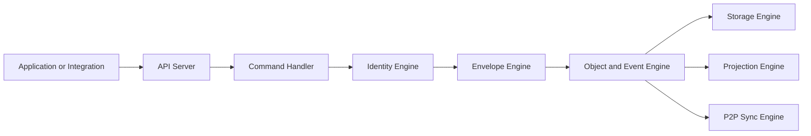

# RFC-0002 — Node Architecture

**Status:** Draft
**Author:** modern_alchemist
**Date:** 2026
**Category:** Architecture Specification

---

# 1. Abstract

This RFC defines the architecture of the **Alkaest Node** for the desktop-first MVP.

The node is the primary execution boundary of the protocol. It is responsible for:

* local identity custody
* command handling
* envelope validation
* event processing
* projection updates
* storage
* network synchronization
* integration with external tools

The first implementation target is a desktop **Standard node**, but the architecture MUST support heterogeneous Light, Standard, and Service profiles from the start, as required by ADR-0003. Profiles may differ in replication, storage, reachability, and offered services; they MUST use the same protocol validation rules for every record they accept. The Light profile is a future implementation target, not a reason to defer the architectural boundaries it requires.

---

# 2. Goals

This RFC defines:

* the responsibilities of a node
* the internal runtime components of a node
* the boundary between applications, integrations, and the node
* the MVP deployment model
* the lifecycle of commands entering and leaving the node

This RFC does not define:

* marketplace workflow rules
* reputation algorithms
* settlement or escrow mechanisms
* GitHub-specific workflow behavior

Those concerns belong in later RFCs.

---

# 3. Context

RFC-0001 establishes that:

* protocol logic is node-first
* applications interact through a node API
* nodes communicate through a P2P network
* state is represented through signed envelopes and events

The current project direction adds the following MVP assumptions:

* the first domain is open-source development coordination
* the MVP is desktop-first
* each developer runs a local node
* GitHub is an integration layer, not the protocol
* the first project coordinated through the network is expected to be Alkaest itself

This RFC turns those assumptions into an implementation-aware architecture.

---

# 4. MVP Node Model

## 4.1 Standard node as the first implementation target

The first implementation target is a **Standard node** running locally on a desktop or workstation. The MVP client and APIs MUST not assume that every participant runs a Standard node: a Light node may hold only its own identities and spaces and fetch other data on demand, while Service nodes may provide optional relay, archive, indexing, or mailbox roles.

The Standard node stores and processes:

* local identities and signing keys
* protocol envelopes relevant to synchronized spaces
* object and event history
* materialized query projections
* attachment references
* mailbox messages addressed to local identities

The Standard node also exposes a local API for user interfaces, automation, and integrations. The API boundary is shared across deployment profiles; profile-specific capabilities and unavailable data MUST be reported explicitly.

## 4.2 Local-first operation

The default operating model is:

Applications do not implement protocol logic directly.
They delegate protocol actions to the local node.

## 4.3 First implementation scope and profile requirements

The first implementation does not have to deliver a production Light-node client. The architecture and protocol contracts MUST still support:

* partial replication and on-demand retrieval by Light nodes;
* capability advertisement and profile-aware API responses; and
* operation through relays when a Light node is not publicly reachable.

The first implementation target remains a desktop Standard node; the Light profile is the second implementation target. Nodes do not trust a peer's profile label or capability claims as proof of data validity. Every accepted record is validated under the same protocol rules, and replicated state is replayed locally as required by RFC-0005. See ADR-0003 and §16.

---

# 5. Architectural Principles

## 5.1 Node as protocol boundary

The node is the only component that:

* signs protocol actions
* validates incoming envelopes
* persists authoritative local protocol state
* publishes protocol data to peers

Applications and integrations must not bypass the node and speak protocol directly.

## 5.2 Clear separation between protocol and integration

External systems such as GitHub, CI providers, file storage, or automation tools are integrations.
They may provide inputs and evidence to the node, but they do not define protocol truth.

## 5.3 Deterministic local processing

Given the same valid envelopes, honest nodes should be able to derive the same projection state.
The node architecture must therefore separate:

* envelope acceptance
* event application
* projection generation

so that validation and replay remain explicit.

## 5.4 Local custody of user authority

For the MVP, private signing authority is expected to be controlled locally by the operator's node.
Remote signing services are not required by this RFC.

---

# 6. Node Responsibilities

An Alkaest Node MUST provide the following responsibilities.

## 6.1 Identity management

The node manages local protocol identities and the keys used to sign commands and envelopes.

Responsibilities include:

* creating local identities
* loading local identities
* selecting the active identity for a command
* signing protocol payloads
* storing local identity metadata

Detailed identity delegation rules belong in a later RFC, but the node architecture must reserve a dedicated identity subsystem.

## 6.2 Command execution

The node accepts commands from applications and integrations, validates local preconditions, and converts valid commands into signed protocol envelopes.

## 6.3 Envelope validation

The node verifies every incoming or locally created envelope before it becomes part of local protocol state.

Validation MUST follow RFC-0004's ordered structural, canonical-byte, hash, identifier, author, signature, and schema checks, followed by RFC-0005 sequencing, permission, and module-transition checks. Implementations MUST finish validation before mutating durable protocol state. Acceptance of an envelope into the append-only record store and advancement of an object's projection MUST be atomic with respect to local failure: a failed write or projection transaction MUST leave neither a partial record nor a partially advanced head.

## 6.4 Event and object processing

The node stores valid protocol objects and events, then rebuilds or advances local read models and indexes under RFC-0005. Local `applied` status is a revisable projection over the currently known event set, not global finality.

## 6.5 Storage

The node persists enough data to:

* reconstruct local protocol state
* answer queries
* recover after restart
* resynchronize with peers

### 6.5.1 Durable admission, projection commit, and rebuild

An envelope MUST pass the applicable framing/resource limits and RFC-0004 validation before it enters the admitted protocol-record set. RFC-0005 then classifies its event against the complete locally known branch set. A valid event may be admitted as `pending` or `conflicting` without advancing the canonical object head; those are durable classifications, not partial application.

Admission of a valid envelope, its event classification, and any resulting projection/head change MUST be one recoverable local commit. When the record store and projection share a transactional store, commit them in one transaction. When they do not, use a durable write-ahead/admission record and a committed projection cursor or generation so restart can deterministically finish or retry projection before exposing the new head. Do not publish sync inventory, emit success notifications, or trigger external effects until the admission commit is durable. Duplicate `envelopeId` delivery is idempotent.

A rejected event MUST NOT advance protocol state. If retained for audit or diagnostics, it MUST be stored in a bounded quarantine/diagnostic path that is distinct from the admitted event log and cannot be replayed as valid protocol history. A crash before commit leaves no admitted transition; a crash after commit preserves the admitted record and allows projection recovery from it.

Projection rebuild MUST read only the admitted immutable records and the versioned protocol/module rules they reference, compute a complete replacement generation, and atomically switch the active generation after successful completion. A failed rebuild leaves the prior generation visible and retryable; partial indexes or a partially advanced head MUST never be exposed. Nodes MUST be able to verify the new generation by replaying the same admitted record set. These commit and rebuild rules apply to every profile; lower local resource caps may defer work but cannot alter the replay result.

## 6.6 P2P synchronization

The node communicates with peers to:

* discover peers
* exchange inventories
* request missing data
* publish newly accepted envelopes
* relay mailbox traffic

## 6.7 Query serving

The node exposes query interfaces for local applications and automation.
Queries operate on projections rather than mutating protocol state directly.

## 6.8 Integration execution

The node may run integration adapters that transform external events into protocol-relevant inputs.

Examples include:

* GitHub webhook processing
* repository metadata ingestion
* CI result capture
* attachment upload coordination

These adapters remain subordinate to protocol validation.

---

# 7. Internal Runtime Components

The MVP node runtime is divided into the following internal components.

## 7.1 API Server

The API Server exposes the local application boundary.

It is responsible for:

* receiving commands
* serving queries
* exposing streams or subscriptions
* authenticating local clients if configured
* mapping API requests into runtime operations

The API surface itself is defined by a later RFC.

## 7.2 Command Handler

The Command Handler receives commands from the API Server or internal integrations.

It is responsible for:

* syntactic command validation
* identity selection
* permission prechecks
* payload assembly
* forwarding to the signing and envelope pipeline

## 7.3 Identity Engine

The Identity Engine manages local identities and signing operations.

It is responsible for:

* key storage
* signing requests
* identity lookup
* local identity metadata
* future support for delegated actors

## 7.4 Envelope Engine

The Envelope Engine creates and verifies protocol envelopes.

It is responsible for:

* canonical payload preparation
* payload hashing
* envelope assembly
* signature verification
* envelope admission checks

## 7.5 Object and Event Engine

The Object and Event Engine applies accepted protocol data to the local state model.

It is responsible for:

* storing accepted objects and events
* ordering local application steps
* rejecting invalid transitions
* replay support
* publishing projection update notifications

## 7.6 Projection Engine

The Projection Engine maintains query-oriented read models.

Examples include:

* spaces by membership
* objects by type
* conversation threads
* work item activity history
* evidence linked to a target object

Projections are derived state and may be rebuilt from accepted envelopes and events.

## 7.7 Storage Engine

The Storage Engine persists both append-oriented protocol data and local indexes.

At minimum it must support:

* durable protocol object storage
* durable event storage
* durable envelope storage
* projection persistence
* mailbox persistence
* local configuration persistence

## 7.8 P2P Sync Engine

The P2P Sync Engine manages communication with other nodes.

It is responsible for:

* peer discovery
* peer session management
* inventory exchange
* object and envelope requests
* publish propagation
* mailbox relay coordination

## 7.9 Mailbox Service

The Mailbox Service handles encrypted message relay and retrieval for local identities.

It is responsible for:

* storing locally addressed encrypted messages
* fetching queued messages from peers
* exposing mailbox state to the query layer

## 7.10 Integration Adapters

Integration Adapters connect the node to external systems without making those systems protocol-authoritative.

For the MVP, GitHub integration is expected to be implemented here rather than inside core runtime components.

---

# 8. Reference Internal Flow

The following flow describes how a typical command moves through the node.

The order above is conceptual.
An implementation may batch or pipeline work internally, but it must preserve the same logical boundaries.

---

# 9. Deployment Model

## 9.1 Local workstation deployment

The default deployment target for the MVP is a developer workstation.

A typical deployment includes:

* one local node process
* one local user interface
* optional local automation
* optional external integrations

## 9.2 Multi-identity support

A single node MAY manage multiple local identities.

This is useful for:

* separate work contexts
* testing and development
* future agent-assisted workflows

Identity separation must be preserved even when identities share the same runtime instance.

## 9.3 Remote node operation

Remote or shared-node deployments are not forbidden, but they are not the MVP reference model.
This RFC does not require architecture optimized for managed multi-tenant hosting.

---

# 10. Interaction with GitHub

GitHub is treated as an external integration layer.

In the MVP:

* GitHub issues, pull requests, comments, and CI results may be observed by integration adapters
* those observations may become Evidence or trigger local commands
* GitHub data does not replace protocol objects, events, or decisions

The first practical reference case for this integration is expected to be the `alkaest-network` project, where Alkaest-related donations are mapped into issue-level work coordination for Alkaest contributors.

This preserves the protocol-first design while allowing practical adoption in open-source development workflows.

Detailed GitHub workflow mapping belongs in RFC-0003.

---

# 11. Storage Expectations

This RFC does not lock in a specific database technology.
However, the node architecture assumes storage separation between the following concerns:

* protocol records
* query projections
* mailbox data
* local configuration
* integration state

Implementations may use one storage engine or multiple backing stores as long as these concerns remain logically distinct.

---

# 12. Failure and Recovery Expectations

The node should be able to recover from restart without losing accepted local protocol state.

At minimum, the architecture must support:

* replay of accepted protocol data
* rebuilding of projections
* resuming peer synchronization
* retrying failed outbound propagation

Offline operation is allowed.
When connectivity returns, the node should continue synchronization through the P2P Sync Engine.

---

# 13. Security Considerations

For the MVP node architecture, the primary security assumptions are:

* local private keys must remain under operator control
* untrusted network data must pass envelope validation before admission
* integrations are untrusted inputs until converted into validated protocol actions
* mailbox relays must not require plaintext access to private messages

Detailed threat modeling, delegated key control, and slashing-related security are left to later RFCs.

---

# 14. Future Work

The following are intentionally out of MVP scope:

* light-node profiles
* mobile embedded nodes
* selective sync
* custodial remote signing
* multi-tenant hosted node architecture
* specialized validator-only node roles

These may be introduced by later RFCs once the profile-independent protocol and node boundaries are stable. Partial replication and capability advertisement are already architectural requirements under ADR-0003 and §16.

---

# 15. Summary

The first implementation is a local Standard node, operated by a developer on a desktop-class machine. The node remains the protocol boundary and the trust boundary for client applications and integrations. Storage is profile-dependent; a Light node is not required to retain or serve the full history of its spaces, and a Service node gains no protocol authority by storing or serving more data.

This architecture preserves the node-first model established in RFC-0001 while keeping the MVP focused on desktop-first open-source development coordination. Implementations MUST preserve the profile-independent protocol rules and component boundaries in §16 so Light and Service implementations do not require a protocol redesign.

---

# 16. Node Profiles

Added by ADR-0003. All profiles run the same protocol and validate everything they accept (§6.3); they differ in what they store and serve.

## 16.1 Profiles

* **Light** (phone, browser): own identities, keys and spaces; fetches other data on demand; does not serve other nodes; reaches the network through relays; tolerates long offline periods.
* **Standard** (desktop, mini PC, single-board computer): full history of the spaces it participates in plus a configurable share of other spaces; DHT routing; mailbox for its own identities. This is the MVP profile.
* **Service** (server with public reachability): large replica share, search indexes, archives, relay and bootstrap services, mailbox for light nodes.

## 16.2 Capability advertisement

Each node publishes a signed capability record: profile, offered roles (relay, indexer, archive, mailbox), storage and bandwidth budgets, reachability (public, NAT, relayed) and observed uptime. Roles are chosen automatically within limits set by the operator and can change as conditions change (a laptop on battery stops relaying).

## 16.3 Trust rule

No profile is trusted more than another. Data served by a Service node is accepted only after the receiver verifies signatures and, for state, replays the relevant log. Light nodes query several Service nodes for the same data so that a single one cannot hide information.

## 16.4 Implications for the components in §7

* **P2P Sync Engine (§7.8):** partial replication, multi-source fetching, relay usage for unreachable peers.
* **Storage Engine (§7.7):** storage budgets and eviction for replicas the node does not own.
* **API Server (§7.1):** capability and replication-status queries.

## 16.5 Resource-bound processing

The protocol resource model uses hard limits by data class, with transport negotiation permitted only to select a smaller transfer unit. This adopts the class-based model with capability-aware chunking (B+C in the [resource-bound options analysis](../research/bisq2-resource-bounds-and-dispute-authority.md)); peer-advertised capacity MUST NOT raise a protocol maximum. Each implementation MAY enforce lower local caps and MUST expose a clear retry/defer result when those caps prevent processing a valid record.

Before an envelope or batch can consume unbounded resources, implementations MUST enforce independent bounds for encoded and decoded bytes, JSON depth and member counts, string and array lengths, signatures, batch item count, decompression ratio, concurrent work, processing deadline, and replay work. Attachment bytes MUST remain outside signed event payloads and transfer in bounded, resumable chunks. Sync MUST be paged; a receiver MUST NOT allocate based on a peer's declared total size or item count. Expiring a cache or replica is allowed only where the data class permits it; signed state and evidence needed for replay, appeal, or settlement audit MUST NOT expire under a generic cache TTL.

An over-limit or malformed record MUST be rejected before durable state mutation. A valid record deferred by a lower local cap MUST NOT be reclassified as protocol-invalid, and retrying it under a higher local cap MUST produce the same validation and projection result. Backpressure and local ingress quotas may reduce service availability, but MUST NOT change canonical event meaning or authority.

This RFC does not yet assign numeric class ceilings. RFC-0004/RFC-0005 vectors, payload inventory, and the reproducible benchmark plan in ADR-0009 are prerequisites for selecting and versioning those values. The initial implementation MUST fail closed on resource exhaustion before committing protocol state.
