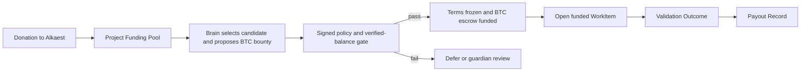

# RFC-0003 — Development Workflow Module

**Status:** Draft
**Author:** modern_alchemist
**Date:** 2026
**Category:** Module Specification
**Related:** ADR-0004, ADR-0006, ADR-0007, RFC-0004, RFC-0005, RFC-0008, RFC-0013, RFC-0014

---

# 1. Abstract

This RFC defines the first domain module built on top of the Alkaest protocol: the **Development Workflow Module**.

The module describes how open-source software work is represented and coordinated on the network.
It defines:

* workflow-specific objects
* workflow-specific events
* the lifecycle of a `WorkItem`
* the role of GitHub as an integration surface
* the MVP funding flow for the first self-hosted project

For the MVP, the first project expected to use this module is **Alkaest itself** through the `alkaest-network` project.
Donations to Alkaest are expected to be allocated to `alkaest-network` issues and then distributed to contributors through this workflow.

---

# 2. Goals

This RFC defines:

* the MVP workflow for open-source development coordination
* the first domain-specific object model above RFC-0001
* how issue-based work maps into protocol entities
* how evidence and validation fit into the workflow
* how funding enters the workflow at the issue level

This RFC does not define:

* final escrow mechanics
* final dispute and mediation rules
* full reputation scoring
* canonical encoding or ID derivation rules
* a GitHub-specific protocol

Those concerns belong in later RFCs.

---

# 3. Context

RFC-0001 defines the generic protocol primitives:

* Space
* Membership
* Object
* Event
* Relation
* Message
* Decision
* Envelope

RFC-0002 defines the MVP node architecture and establishes that:

* the first implementation target is a desktop Standard node, while the architecture supports Light, Standard, and Service profiles
* GitHub is an integration layer, not protocol authority
* the first project coordinated through the network is expected to be Alkaest itself

This RFC defines the first practical workflow module that uses those protocol primitives.

---

# 4. MVP Assumptions

To keep the first workflow implementable, this RFC makes the following MVP assumptions.

## 4.1 First project

The first project coordinated through this module is the `alkaest-network` project.

## 4.2 Donation-first funding

Money donated to Alkaest is treated as the first funding source for the network.
That money is allocated into issue-level work items inside the Alkaest project workflow.

## 4.3 Maintainer-directed issue funding

For the first Alkaest treasury workflow, the founder seeds initial candidate priorities and signed budget boundaries. The Brain selects an eligible candidate and proposes an exact BTC bounty under RFC-0014. A deterministic policy and verified-balance gate authorizes publication and funding; maintainer or guardian review is required only for the exceptions defined by that policy. This does not remove project-local authorization for other Spaces.

## 4.4 Exclusive assignment after acceptance

For the MVP, a funded `WorkItem` is assigned to one contributor at a time after maintainer review and acceptance of that contributor's claim. A claim is not an assignment or a reservation of funds for that identity.

Each assignment MUST be proposed by an authorized assignment actor and separately accepted by the assignee before work starts. The proposal MUST bind the assignee, immutable term version, assignment authority, start-by deadline, delivery deadline, inactivity timeout (if any), and payout-recipient identity. These times are fixed for the assignment; changing them requires a versioned amendment accepted by the assignee. An unaccepted proposal expires without creating an active assignment. If the assignee declines, abandons, or misses the applicable deadline, the assignee or an authorized project maintainer MUST record an assignment release/expiry event before another contributor is assigned. A released assignment does not itself imply misconduct or create reputation evidence. Competitive claiming and parallel bounty races are future options, not part of this MVP baseline.

## 4.5 Settlement and release authorization

Funding intent, validation outcome, and payout eligibility are protocol records. Real treasury authorization follows ADR-0007 and RFC-0014: bounties are funded before work starts, routine accepted work may be authorized for payout automatically under frozen rules, and Bitcoin settlement references and audit anchors make treasury movement traceable. The WorkItem becomes `paid` only after settlement confirmation under RFC-0008. Mainnet execution remains gated; this RFC alone does not authorize real spending.

## 4.6 Post-launch change tracking

After the project activates treasury workflow, every change to maintained code or published project artifacts—including tests, dependencies, configuration, documentation, release assets, and visual identity—must link to a `WorkItem` or a signed maintenance decision. A change may be unpaid, but payment requires a Funding Allocation and escrow created before work begins. RFC-0014 defines the policy and evidence rules.

## 4.7 Frozen terms, conflicts, and recipient authority

Before assignment, a funded `WorkItem` MUST freeze the amount, settlement asset, deliverable, acceptance criteria, base revision, review policy, and payout rule. A change to scope, amount, deadline, or review requirements MUST be a versioned amendment accepted by the assignee before the amended work becomes payout-eligible. Because an envelope has one author, proposal and acceptance MUST be separate signed events; a single event MUST NOT be treated as proof of both parties' consent. If the assignee rejects a material amendment, the assignment is released without treating that rejection alone as failure. Partial payment is allowed only for separately specified, funded milestones with their own acceptance criteria; otherwise no partial amount is implied.

At least one required reviewer MUST be a different protocol identity from the requester, funding authority/treasury agent, assignee, and known related identities. A WorkItem's risk policy MAY require multiple reviewers. A person with a declared or protocol-visible conflict MUST NOT validate that WorkItem. If the required independent review cannot be obtained, the WorkItem remains pending and payout authorization is blocked; the project must use its declared escalation/dispute process rather than silently waiving review.

The payout recipient identity is fixed by the accepted assignment and cannot be taken from GitHub issue/PR text, an AI output, or an integration callback. The settlement destination is supplied in a contributor-signed settlement instruction and verified under RFC-0008. A destination change requires a new contributor signature and must not change the recipient identity, amount, or asset; an ambiguous or conflicting instruction blocks settlement.

## 4.8 Role separation and authority

The project Space policy MUST name the authorities for WorkItem creation, funding allocation, assignment, validation, acceptance, payout authorization, settlement observation, and dispute resolution. These are separate protocol actions even when one identity is authorized for more than one action. A role or provider integration cannot acquire authority merely by operating a GitHub account, CI workflow, node profile, or AI model.

| Role | May do | Must not do by virtue of this role |
|---|---|---|
| Requester / task author | Propose scope and acceptance criteria; submit a candidate WorkItem | Validate their own delivery or create funding authority |
| Funding authority / Treasury Agent | Propose an allocation within signed policy and verified-balance gates; publish the WorkItem after funding is confirmed | Validate or mediate its own funded task; change payout recipient or settlement destination |
| Assignment authority | Select among eligible claims and propose an assignment under Space policy | Activate an assignment without the assignee's separate signed acceptance |
| Assignee | Accept assignment and amendments; submit delivery/evidence and signed settlement instructions | Change frozen terms unilaterally or self-validate |
| Reviewer / validator | Record a result against frozen criteria and exact revisions when conflict-free | Validate when requester, funding authority, assignee, or known related identity; authorize treasury spending solely by review |
| Integration adapter | Submit provenance-labeled observations and evidence references | Create authoritative assignments, acceptance, payout authorization, or settlement confirmation |
| Settlement observer | Submit independently verifiable transaction observations under RFC-0008 | Decide source-code/design acceptance or change frozen payout terms |
| Mediator / appeal authority | Act only under the scoped dispute process in RFC-0013 | Change treasury policy, choose a recipient, or spend funds outside the settlement rules |

At least one required validator MUST be independent of requester, funding authority, assignee, and known related identities. If no eligible validator can serve, the WorkItem remains unresolved and follows its declared escalation path; the policy cannot silently waive this separation. The same review result cannot both establish completion and independently authorize its own payout.

---

# 5. Module Scope

The Development Workflow Module is responsible for coordinating:

* issue-based work selection
* assignment
* implementation activity
* evidence submission
* validation
* payout eligibility

It is not responsible for replacing source control, code review, CI, or project hosting platforms.
Instead, it integrates with them while preserving protocol-native records for workflow truth.

---

# 6. Workflow Concepts

The module introduces the following workflow concepts.

## 6.1 Project Space

A software project is represented by a `Space`.

For the MVP, `alkaest-network` is expected to be one such Space.

## 6.2 WorkItem

A `WorkItem` is the primary workflow object representing a unit of software development work.

Typical examples:

* bug fixes
* features
* refactors
* infrastructure tasks
* documentation tasks

## 6.3 Funding Allocation

A Funding Allocation records that project funds have been reserved for a specific `WorkItem`; it is not merely an estimate or funding intent. The signed event binds the exact immutable WorkItem term version, BTC amount, separately budgeted fees, funding policy version, treasury ledger head, and expiry/refund path. The allocation is not spendable by another WorkItem while active.

In the MVP, Funding Allocation may represent:

* donation-derived issue funding
* sponsor-directed issue funding
* project treasury allocation

## 6.4 Evidence

Evidence is any material used to support the completion or validation of a `WorkItem`.

Examples:

* commits
* pull requests
* CI runs
* test output
* build artifacts
* reviewer notes

## 6.5 Validation Outcome

A Validation Outcome records whether submitted work satisfies the `WorkItem` requirements strongly enough to qualify for acceptance and payout.

---

# 7. Workflow Objects

This module defines the following primary object types.

## 7.1 WorkItem

`WorkItem` is the main domain object.

Recommended object type:

```text
work_item
```

Recommended schema:

```text
alkaest.workflow.work_item.v1
```

Suggested payload:

```text
WorkItem
- workItemId
- projectSpaceId
- termVersion
- title
- descriptionRef (or privacy-safe inline description)
- externalIssueRef (optional, evidence/integration reference only)
- workStatus (derived protocol projection)
- fundingStatus (derived protocol projection)
- settlementStatus (derived protocol projection)
- complexity
- bounty { asset: "BTC", amountSats: uint }
- feeBudgetSats: uint
- fundingAllocationId
- escrowRef (created after confirmed funding)
- requestedByIdentityId
- assigneeIdentityId (set by accepted assignment)
- payoutRecipientIdentityId (bound to accepted assignment)
- validatorPolicy
- acceptanceCriteria
- deliverableRefs
- evidenceRefs
- createdAt
- updatedAt (derived projection metadata; not part of the immutable signed creation record)
```

### Notes

- `externalIssueRef` may point to a GitHub issue.
- `bounty.amountSats` is an exact integer satoshi amount frozen before assignment; fiat estimates and AI-generated balances are not funding authority.
- `feeBudgetSats` is separately disclosed and reserved; the signed terms state who bears any fee above the cap. Do not silently deduct fees from the contributor's frozen bounty.
- The WorkItem's signed terms are immutable. Status fields are projections of validated events, not mutable signed fields.
- `validatorPolicy` may reference project-defined validation expectations.

## 7.2 FundingAllocation

Recommended object type:

```text
funding_allocation
```

Recommended schema:

```text
alkaest.workflow.funding_allocation.v1
```

Suggested payload:

```text
FundingAllocation
- allocationId
- sourceType
- sourceRef
- workItemId
- termVersion
- asset (BTC)
- bountySats
- feeBudgetSats
- ledgerEventHead
- policyVersion
- escrowProfile (RFC-0008 profile identifier)
- expiryPolicyRef
- allocatedByIdentityId
- createdAt
```

### MVP interpretation

For the Alkaest bootstrap workflow, `sourceType` will often represent a donation pool or project treasury decision.

## 7.3 EvidenceRecord

Recommended object type:

```text
evidence
```

Recommended schema:

```text
alkaest.workflow.evidence_record.v1
```

Suggested payload:

```text
EvidenceRecord
- workItemId
- termVersion
- evidenceType
- provenanceKind (protocol_signed | provider_signed | adapter_attested | contributor_submitted)
- sourceProvider
- sourceSubjectRef (for example project/repository, pull request, workflow run, or release)
- sourceRevisionOrRunId (when applicable)
- observedAt
- contentDigest (for immutable revision/artifact content)
- externalLocator (optional, mutable URL or provider-native locator)
- providerAttestationRef (when the source provider supplies a verifiable signature)
- adapterIdentityId (required when provenanceKind is adapter_attested)
- attachmentRefs
- submittedByIdentityId
- summary
- visibility (public | space_members | restricted)
- createdAt
```

### Evidence provenance rules

Every evidence record MUST bind to the frozen `WorkItem` term version and identify who made the claim, what exact object/revision/run it concerns, when it was observed, and its provenance class. Mutable URLs are locators only; code, document, and artifact evidence used for acceptance MUST include an immutable revision or content digest. Provider-signed evidence is accepted as a provider assertion only after signature and subject binding are verified. When a provider does not supply a verifiable signature, the adapter signs an observation bound to the exact provider, repository/tenant, commit or artifact digest, pull request, and workflow run; this proves what the adapter observed, not that the provider's claim is protocol truth. Contributor-submitted links and summaries remain claims until the frozen validator policy accepts them.

Evidence provenance MUST remain visible in review records. An adapter MUST NOT convert an unsigned provider response into a provider-signed claim, and a green CI status, merged pull request, or mutable issue state MUST NOT by itself satisfy acceptance. Sensitive evidence MUST use the WorkItem's declared visibility and retention rules; only privacy-safe references or digests belong in public events or audit anchors.

## 7.4 ValidationRecord

Recommended object type:

```text
validation_record
```

Recommended schema:

```text
alkaest.workflow.validation_record.v1
```

Suggested payload:

```text
ValidationRecord
- workItemId
- termVersion
- validatorIdentityId
- submittedRevisionOrDigest
- outcome (pass | request_revision | reject_final)
- criterionResults
- conflictCheckResult
- notes
- evidenceRefs
- createdAt
```

Each `work_item.validation_attested` event MUST cite the exact submitted revision/digest and frozen term version. `pass` is a validator result, not by itself the protocol's `accepted` state; the acceptance authority records `work_item.accepted` only after every frozen review gate passes. `request_revision` and `reject_final` map to the distinct transitions in §10. A final rejection does not itself cancel the WorkItem or determine reputation.

## 7.5 PayoutRecord

Recommended object type:

```text
payout_record
```

Recommended schema:

```text
alkaest.workflow.payout_record.v1
```

Suggested payload:

```text
PayoutRecord
- payoutId
- workItemId
- recipientIdentityId
- asset (BTC)
- amountSats
- feeBudgetSats
- settlementId
- escrowRef
- settlementStatus
- settlementRef
- createdAt
```

This object is a projection/reference to payout events. It MUST distinguish authorization, transaction broadcast, chain observation, confirmed settlement, refund, and contested states; it cannot itself assert that payment occurred.

---

# 8. Workflow Events

This module defines the following recommended event types.

```text
work_item.created
work_item.opened
treasury.allocation_created
treasury.allocation_released
treasury.escrow_funding_broadcast
treasury.escrow_funding_observed
treasury.escrow_funded
treasury.escrow_funding_failed
work_item.claim_requested
work_item.claim_withdrawn
work_item.claim_declined
work_item.assignment_proposed
work_item.assignment_accepted
work_item.assignment_declined
work_item.assignment_expired
work_item.assignment_released
work_item.terms_amendment_proposed
work_item.terms_amendment_accepted
work_item.started
work_item.evidence_added
work_item.submitted
work_item.validation_attested
work_item.revision_requested
work_item.accepted
work_item.rejected
work_item.payout_authorized
work_item.refund_authorized
treasury.payout_broadcast
treasury.payout_observed
treasury.payout_settled
treasury.refund_broadcast
treasury.refund_observed
treasury.refund_settled
treasury.settlement_reorged
treasury.settlement_contested
work_item.closed
work_item.canceled
```

These event names are module conventions built on top of the generic Event model from RFC-0001.

---

# 9. WorkItem Lifecycle

The MVP lifecycle is:

```mermaid
flowchart LR
    ISSUE["Candidate Need"] --> ITEM["WorkItem terms frozen"]
    ITEM --> ALLOC["BTC allocation reserved"]
    ALLOC --> ESCROW["Escrow funding observed and confirmed"]
    ESCROW --> OPEN["WorkItem opened"]
    OPEN --> CLAIM["Claim Requested"]
    CLAIM --> APROPOSE["Assignment proposed"]
    APROPOSE --> AACCEPT["Assignee accepts"]
    AACCEPT --> ASSIGN["Assigned"]
    ASSIGN --> BUILD["Work Performed"]
    BUILD --> EVIDENCE["Evidence Submitted"]
    EVIDENCE --> VALIDATE["Validation"]
    VALIDATE --> ACCEPT["Accepted"]
    ACCEPT --> AUTHORIZE["Payout Authorized"]
    AUTHORIZE --> BROADCAST["Payout transaction broadcast"]
    BROADCAST --> OBSERVED["Transaction observed in chain"]
    OBSERVED --> SETTLE["Settlement threshold reached"]
    SETTLE --> CLOSE["Closed"]
```



## 9.1 Issue identified

A project issue exists, either natively in protocol planning or through GitHub integration.

## 9.2 Candidate selected and funding proposed

The Brain evaluates an eligible candidate and proposes the exact BTC bounty under RFC-0014. A deterministic policy and verified-balance gate authorizes the funding allocation. A candidate or proposal is not an allocation and cannot be presented as a payable task.

## 9.3 WorkItem opened

A protocol-native `WorkItem` freezes scope, acceptance criteria, exact BTC bounty, fee budget, reviewer policy, and expiry/refund terms. Creating it does not imply funding.

## 9.4 Allocation and escrow funding

An authorized allocation reserves the exact bounty and fee budget against the current verified ledger head. Bitcoin transaction broadcast is recorded separately from observation and confirmation. Only after the configured funding threshold is independently verified may the WorkItem become `funded` and `open`; a wallet's unverified callback or a pending transaction is insufficient. RFC-0008 defines the settlement profile and transitions.

## 9.5 Claim requested

A contributor expresses interest in doing the work.

## 9.6 Assignment proposed and accepted

An authorized assignment actor selects one eligible claim and emits `work_item.assignment_proposed`, binding the assignee, immutable term version, start-by deadline, delivery deadline, inactivity timeout (if any), and payout recipient identity. The assignee must emit a separate `work_item.assignment_accepted` event referencing the exact proposal digest. Only then does the projection enter `assigned`; a proposal is not an active assignment or a second reservation of funds. Decline or an authorized `work_item.assignment_expired` event for that proposal returns the WorkItem to `open`. A local clock or provider callback alone cannot expire it. No second active assignment is permitted.

## 9.7 Work performed

The assigned contributor performs the work in their normal development tools and repository flow.

## 9.8 Evidence submitted

The contributor or integration adapter submits protocol-visible evidence such as commits, pull requests, CI results, or artifacts.

## 9.9 Validation

Validators or project-authorized reviewers evaluate the evidence and determine whether acceptance criteria are satisfied.

Every validation MUST reference the frozen WorkItem term version and exact submitted revision. A reviewer conflict blocks validation. Changes to acceptance criteria after work begins require the amendment procedure in §4.7; a merged PR or passing CI alone does not override the frozen criteria.

## 9.10 Accepted

The work is accepted as complete for the workflow.

## 9.11 Payout authorized

The workflow records that the release policy authorized a specific payout. This is not evidence that funds moved.

## 9.12 Closed

The `WorkItem` is closed once the workflow is complete.

---

# 10. WorkItem Status Model

The projected `workStatus` is:

```text
draft
funded
open
claimed
assignment_pending
assigned
in_progress
submitted
revision_requested
accepted
rejected
payout_authorized
paid
settlement_reorged
closed
canceled
```

These workflow statuses are separate projections from funding and settlement:

```text
fundingStatus:
unfunded | allocation_reserved | allocation_released | funding_pending | funded | refund_pending | refunded | funding_failed | contested

settlementStatus:
none | payout_authorized | broadcast | observed | confirmed | reorged | refund_authorized | refund_broadcast | refund_observed | refunded | contested
```

### WorkItem transitions

Only the transitions below are valid in the MVP. Each transition is derived from the cited signed event(s) and must pass RFC-0005 sequencing and the active Space policy.

| Current `workStatus` | Event and guard | Next `workStatus` |
|---|---|---|
| `draft` | Confirmed escrow funding binds the frozen term version | `funded` |
| `funded` | Authorized `work_item.opened` | `open` |
| `open` | One or more valid `claim_requested` events | `claimed` |
| `claimed` | All pending claims withdrawn/declined with no assignment proposal | `open` |
| `claimed` | Authorized `assignment_proposed` | `assignment_pending` |
| `assignment_pending` | Assignee signs `assignment_accepted` for the exact proposal digest | `assigned` |
| `assignment_pending` | Assignee signs `work_item.assignment_declined`, or authorized `work_item.assignment_expired` resolves the exact proposal | `open` |
| `assigned` | Assignee emits `work_item.started` under the accepted assignment | `in_progress` |
| `assigned` | `work_item.assignment_released` before work starts | `open` |
| `in_progress` | Authorized `work_item.assignment_released` or `work_item.assignment_expired` resolves the exact assignment | `open` |
| `in_progress` | Assignee emits `work_item.submitted` with evidence bound to the frozen term version | `submitted` |
| `submitted` | Required validator emits `work_item.revision_requested` | `revision_requested` |
| `revision_requested` | Same assignee resumes with `work_item.started` within accepted terms/deadline | `in_progress` |
| `submitted` | Authorized final validation emits `work_item.rejected` | `rejected` |
| `submitted` | Frozen validation gates pass and authorized acceptance emits `work_item.accepted` | `accepted` |
| `rejected` | `work_item.assignment_released`; WorkItem remains eligible for another claim | `open` |
| `accepted` | Treasury policy gates pass, no unresolved RFC-0013 case blocks payment, and `work_item.payout_authorized` binds amount/recipient | `payout_authorized` |
| `payout_authorized` | `treasury.payout_settled` is confirmed under RFC-0008 | `paid` |
| `paid` | `treasury.settlement_reorged` invalidates the current confirmation | `settlement_reorged` |
| `paid` | `work_item.closed`; no open protocol or settlement obligations remain | `closed` |
| Any nonterminal state before `paid` | Authorized cancellation; any active assignment is released | `canceled` |
| `canceled` | `work_item.closed`; no funds were allocated or refund settlement is confirmed, and no other obligations remain | `closed` |
| `settlement_reorged` | `treasury.payout_settled` is re-confirmed under RFC-0008 | `paid` |

`rejected` describes a delivery result, not a finding of misconduct and not necessarily cancellation of the WorkItem. An RFC-0013 dispute is a separate case object; it does not overwrite `workStatus`. An unresolved case blocks payout authorization and closure. If settlement itself is contested, `settlementStatus` becomes `contested` under RFC-0008. `canceled` records the cancellation decision; if escrow exists, `fundingStatus` remains `refund_pending` until RFC-0008 confirms the refund. `closed` is terminal and MUST NOT be entered while an allocation, escrow, payout, refund, dispute, or appeal remains unresolved.

### Funding and settlement transitions

`fundingStatus` follows `unfunded -> allocation_reserved -> funding_pending -> funded`. `treasury.allocation_created` reserves the amount against the exact WorkItem term version and verified ledger head; transaction broadcast changes the state to `funding_pending`; only independent RFC-0008 verification reaches `funded`. An allocation released before broadcast becomes `allocation_released`; an expired or invalid funding attempt becomes `funding_failed`. A failed attempt cannot be treated as funded or reopened without a new authorized allocation. Cancellation of funded work yields `refund_pending -> refunded`; the reservation moves atomically between ledger categories and MUST NOT be counted twice as both an allocation and escrow.

`settlementStatus` follows `none -> payout_authorized -> broadcast -> observed -> confirmed`. A refund uses `refund_authorized -> refund_broadcast -> refund_observed -> refunded`. `contested` blocks automatic settlement while the applicable RFC-0013/RFC-0008 path runs. A reorganization after `observed` or `confirmed` changes the current projection to `reorged` and blocks further automatic payout until RFC-0008 recovery; prior signed settlement events remain in history. `paid` is a revisable projection of currently valid confirmed settlement, not an irreversible assertion based on an old event.

### MVP rules

- A `WorkItem` MUST NOT move to `open` or `assigned` until the required escrow funding is confirmed under RFC-0008 and an immutable funded term version is bound to the escrow.
- `assignment_pending` is reachable only from a funded `claimed` WorkItem; it does not itself reserve funds for or authorize work by the proposed assignee.
- A `WorkItem` MUST have at most one active assignment in the MVP.
- `assignment_proposed` and `assignment_accepted` MUST be separate signed events over the same proposal digest. A claim or proposal alone does not reserve funds for a contributor or make that identity the active assignee.
- `assignment_declined` or an authorized `assignment_expired` event for an unaccepted proposal returns the WorkItem to `open`; reassignment after an accepted assignment requires `assignment_released` or `assignment_expired` for that exact assignment. A local clock or external provider callback alone is not expiry evidence.
- `assignment_released` MUST identify the prior assignment and reason category; only the assignee or an authorized project maintainer may release it. It MUST NOT by itself imply misconduct.
- `terms_amendment_proposed` MUST reference the prior term version and complete replacement terms or a canonical digest. `terms_amendment_accepted` MUST be a separate event signed by the assignee and reference the exact proposal event/digest. An amendment without that acceptance MUST NOT change payout eligibility.
- `accepted` means workflow acceptance, not necessarily final reputation issuance.
- `work_item.accepted` MUST be a distinct authorized event after the required validator records pass against the exact revision and frozen term version. A validator's `pass` record alone does not accept the WorkItem.
- An open RFC-0013 dispute case blocks `work_item.payout_authorized` and `work_item.closed`; case lifecycle and decisions are recorded on the separate dispute object. A dispute verdict does not itself authorize or confirm a Bitcoin spend.
- `payout_authorized` means the release policy approved a specific payout; it does not mean funds moved.
- `paid` MUST mean settlement is confirmed by the settlement layer defined in RFC-0008. A payout intent, authorization, or unverified provider callback MUST NOT set this status.
- A detected reorganization changes `settlementStatus` to `reorged` and `workStatus` to `settlement_reorged`, blocks further automatic payment, and follows RFC-0008 recovery; prior signed settlement events remain in history.
- WorkItem lifecycle `accepted` and settlement `confirmed` remain distinct. Only a confirmed payout sets workflow status `paid`.
- `closed` is a terminal projection and MUST wait until no allocation, escrow, payout, refund, dispute, or appeal remains unresolved; `canceled` is not equivalent to `closed` while a refund is pending.
- `claim_requested` is an event, not a status. `claimed` means a claim is pending assignment review; only `assigned` grants the contributor an active assignment.
- An assignment MUST have fixed start-by and delivery deadlines; assignment expiry/release requires an authorized event before reassignment.
- A material scope or deadline amendment requires assignee acceptance; refusal alone is not a failed contribution.
- Payout authorization requires the frozen review policy to pass with no known reviewer conflict. The recipient identity comes from the accepted assignment; the settlement destination comes only from a contributor-signed instruction verified under RFC-0008.
- Partial payout is available only for predeclared, separately funded milestones; no prorated payment is inferred for incomplete work.

---

# 11. Funding Flow for the Bootstrap Project

The first practical funding flow is expected to look like this:



## 11.1 Donation intake

Money donated to Alkaest enters a project-controlled funding pool.

## 11.2 Allocation decision

The founder seeds initial candidate priorities and policy limits. The Brain proposes the eligible issue and exact BTC bounty; a deterministic policy and ledger gate authorizes the allocation. It records `defer` or guardian review when evidence, pricing, or available funds fail a gate (RFC-0014).

## 11.3 Issue funding

Once exact terms and a funding allocation are recorded, escrow may be funded. Only a confirmed escrow becomes a funded, open, claimable WorkItem.

## 11.4 Contributor payout path

When work is completed and validated, the workflow creates signed records needed to justify payout. Routine uncontested bounty work can be authorized by the treasury agent when predeclared release evidence passes. Required independent approval, merge status, and CI/security checks must refer to the exact revision. The PR provider remains an evidence source, not the authority for payment. RFC-0014 defines policy and authorization; RFC-0008 defines Bitcoin escrow settlement and confirmation; RFC-0013 defines disputes. Only confirmed settlement advances status to `paid`.

---

# 12. GitHub Integration Boundary

GitHub is a useful integration surface for the development workflow, but it is not protocol authority.

GitHub integrations MAY provide:

* issue metadata
* labels
* pull request links
* comments
* review states
* CI references

GitHub integrations MUST NOT be treated as the sole source of truth for:

* assignment
* protocol acceptance
* payout authorization
* reputation effects

Those outcomes must still be represented inside Alkaest protocol objects, events, or decisions.
For funded code tasks, GitHub review and merge events are bound to immutable revisions and recorded as evidence. Payment requires the protocol's release decision and settlement record, not merely a green GitHub status.

---

# 13. Roles in the Workflow

The MVP workflow assumes the following practical roles.

## 13.1 Maintainer

Responsible for:

* selecting funding candidates
* opening funded `WorkItem`s
* reviewing claim requests
* assigning work
* approving or delegating validation

## 13.2 Contributor

Responsible for:

* claiming work
* implementing the task
* submitting evidence
* responding to review

## 13.3 Validator

Responsible for:

* reviewing evidence
* determining whether acceptance criteria are met
* producing validation records

For the MVP, validator membership may be project-declared.

---

# 14. Project Integration Configuration

Projects using this module will likely need a project-local configuration file.

This RFC expects a future `.alkaest/project.yaml` draft to define fields such as:

* project identity
* repository references
* validator policy
* maintainer identities
* funding policy
* issue eligibility rules
* evidence requirements

That file format is not finalized here, but this RFC establishes the need for it.

---

# 15. Decisions and Constraints

The following constraints are intentional for the MVP:

* the workflow is issue-centric
* assignment is exclusive after acceptance
* funding is authorized by a signed project policy; for Alkaest's first treasury workflow, the Brain ranks seeded candidates and a deterministic policy/balance gate authorizes each in-bounds allocation (RFC-0014)
* GitHub remains an integration surface
* payout eligibility can be represented before settlement is enabled; real treasury payout follows ADR-0007/RFC-0014 and RFC-0008
* the first reference project is Alkaest itself

These choices optimize for clarity and operational feasibility over maximum market flexibility.

---

# 16. Open Areas for Later RFCs

This RFC leaves the following to later RFCs:

* final settlement mechanics in RFC-0008
* automated escrow and bond logic
* treasury policy schemas, release evidence and Bitcoin audit anchors in RFC-0014
* full dispute procedures
* reputation issuance rules
* validator selection markets
* non-exclusive bounty competition
* generalized multi-project funding allocation markets

---

# 17. Summary

The Development Workflow Module is the first concrete domain module for Alkaest.
It turns the protocol into a system that can coordinate real open-source work.

For the MVP, the most important outcome is practical and self-hosting:

* Alkaest coordinates the development of Alkaest
* `alkaest-network` issues become the first protocol work items
* donations to Alkaest become issue-level funding inputs
* contributors become the first developers paid through the network

That gives the protocol a real project, a real funding flow, and a real test of whether the architecture is useful.
