# RFC-0008 — Bitcoin Escrow and Settlement

**Status:** Draft; no production or real-funds authorization
**Date:** 2026-10-19
**Category:** Settlement Module
**Related:** ADR-0004, ADR-0006, ADR-0007, RFC-0003, RFC-0004, RFC-0005, RFC-0013, RFC-0014

## 1. Abstract

This RFC defines the settlement boundary for BTC-funded Alkaest WorkItems. The protocol records immutable task terms, funding reservations, escrow references, payout/refund authorization, Bitcoin transaction observations, and settlement status. Bitcoin transfers value; Alkaest's signed event log remains authoritative for work terms, policy, and workflow decisions.

The first conformance target is **on-chain BTC on an isolated Bitcoin `regtest` network**. Lightning, fiat collateral, stablecoins, tokenized assets, and mainnet spending are outside this draft's executable scope. A contributor may independently use Bisq after receiving BTC; Bisq is not an Alkaest settlement processor.

This is an interface and threat-boundary draft. It does not select production key custody, mediator selection, a mainnet confirmation threshold, or a safe timeout/refund branch. Those are launch blockers, not implementation defaults.

## 2. Goals and non-goals

Goals:

- Bind an exact BTC bounty, fee budget, WorkItem term version, recipient identity, and escrow output before assignment.
- Distinguish allocation, transaction broadcast, chain observation, settlement confirmation, refund, and reorganization.
- Let independent implementations verify transaction amounts, inputs, outputs, fee bounds, event ordering, and references.
- Make retries idempotent and fail closed on conflicts, stale evidence, unknown transaction state, or insufficient verified funds.
- Support interoperable offline signing workflows without exposing private keys to Alkaest.

Non-goals:

- Define mediation eligibility, verdict, or appeal rules (RFC-0013).
- Treat a Bitcoin transaction or audit anchor as proof that work met its acceptance criteria.
- Require every heterogeneous Alkaest node to host a Bitcoin full node.
- Use a token or a custom chain for treasury consensus.
- Guarantee fiat conversion or Bisq liquidity.

## 3. Initial settlement profile

The sole initial conformance profile is `btc-onchain-p2wsh-2of3-regtest-v0`:

- Asset: BTC, represented in signed protocol events as a non-negative integer `amountSats`.
- Network: Bitcoin `regtest`; chain/network identity is bound into every address, script, and transaction observation.
- Escrow candidate: a native SegWit v0 P2WSH output containing a 2-of-3 multisignature script for creator/funding authority, assigned contributor, and the mediator identity fixed before escrow creation. P2WSH is defined by BIP-0141; PSBT is the interchange format for unsigned/partially signed transactions under BIP-0174.
- Cooperative release candidate: creator/funder and contributor sign the exact payout transaction; mediator signature is not required when both parties agree.
- Disputed spending: not enabled until RFC-0013 defines a valid verdict/appeal outcome and exact required signers. This draft MUST NOT invent mediator powers.
- Timeout and unilateral recovery: unspecified. No client may infer a refund solely from a local clock, task deadline, or absence of a response.
- Production chain observation/finality: unspecified. `regtest` success is not evidence of mainnet safety.

The 2-of-3 script is a candidate mechanism, not an enforcement of Alkaest policy. Any two key holders may be able to create a valid Bitcoin spend even if that spend violates an Alkaest event rule. Nodes can detect and report such a spend; the script alone cannot force a signer to follow protocol policy. A script/key design that reduces this gap and the mediator-key lifecycle require independent security review before any real BTC.

## 4. Amounts, funding, and fees

Every amount is an integer number of satoshis. Floating-point BTC and fiat values MUST NOT appear in signed settlement fields. A work offer may originate from a fiat-denominated quote, but before allocation the quote-to-BTC rule must produce and freeze an exact `bountySats`, a reference source/time, rounding rule, fee treatment, and expiry. Later market movement does not silently change the funded terms.

The funding reservation is the exact sum of:

```text
required_reservation_sats = bounty_sats + fee_budget_sats
```

The task's Bitcoin escrow output locks at least `bountySats`. The funder separately supplies the transaction fee inputs or fee budget; the contributor's frozen bounty MUST NOT be reduced silently to pay miner fees. Actual funding and spend transactions MUST satisfy the profile's declared fee cap and output rules. Excess fee, missing output, duplicate escrow, unrecognized change, or value overflow fails validation and MUST NOT partially update the ledger.

The balance gate MUST atomically reserve this full amount against the ledger event head named by the allocation. Concurrent allocations against one head must be serialized through the signed event/state-resolution rules; a stale head or duplicate reservation is rejected. Escrowed, reserved, or payout-pending sats cannot be counted as spendable for another WorkItem.

Ledger projection categories MUST be disjoint. Before the funding transaction confirms, the full bounty-plus-fee budget is in `reserved_allocations`. After escrow funding confirms, the bounty moves from that category to `outstanding_escrow`; any unspent fee budget stays reserved until spent or explicitly released. A payout authorization against an already-counted escrow output does not also add the same bounty to `authorized_pending_payouts`. `committed_network_fees` includes only obligations not already represented in the allocation, escrow, or pending-payout category. When a transaction settles, the ledger transitions the corresponding value once; it MUST NOT subtract one economic obligation twice.

This RFC does not adopt ADR-0006's proposed maintenance or mediator percentages as current rates. Any such fee requires a versioned, explicit policy, a separately calculated output, and contributor-visible terms frozen before assignment.

## 5. Signed settlement records

RFC-0003 defines WorkItem terms and workflow lifecycle. RFC-0014 defines treasury policy and release authorization. RFC-0008 adds settlement-specific records/events; values below are schema requirements, not finalized canonical encodings (RFC-0004):

### 5.1 Allocation

`treasury.allocation_created` MUST bind:

- `allocationId`, `workItemId`, exact `termVersion` and its canonical digest;
- asset/network (`BTC`, `regtest` in the first profile), `bountySats`, `feeBudgetSats`, and the payer for each fee class;
- funding source reference, signed policy version, ledger event head/snapshot digest, and resulting reserved amount;
- escrow profile, escrow participants' protocol identities/public keys, expiry-policy reference, and milestone ID if applicable;
- event predecessor/head and allocator signature.

It reserves funds in the Alkaest ledger but does not prove a Bitcoin transaction has been broadcast or confirmed.

### 5.2 Escrow funding observation

`treasury.escrow_funding_broadcast` records the signed allocation reference, transaction ID and witness transaction ID where applicable, raw transaction bytes or a digest-addressed retrievable reference, escrow output index, and broadcaster identity. It changes the allocation projection to `funding_pending`; it does not establish that the transaction reached the network or that the escrow is funded. A replacement transaction requires a versioned attempt linked to the same active allocation and must not create a second reservation.

`treasury.escrow_funding_observed` MUST bind a deterministic `settlementId`, Bitcoin-defined transaction ID (and witness transaction ID where applicable), raw transaction bytes or a content-addressed retrievable reference with digest, escrow output index, exact output value and scriptPubKey, transaction fee, chain identity, observed block hash/height (or explicit mempool state), observer identity/source, and the referenced allocation. A digest without retrievable transaction bytes is insufficient for independent validation. Mempool observation is `funding_pending`, never `funded`.

`treasury.escrow_funding_failed` records a verifiable failure/rejection for a specific funding attempt and its evidence/reason class. It does not release the allocation or make the funds spendable again unless the ledger independently verifies that no transaction can consume the reservation and an authorized `treasury.allocation_released` transition succeeds.

`treasury.escrow_funded` is a derived/verified event only after the configured profile's funding threshold is met, the transaction is in the accepted active chain, the escrow output matches the committed script and value, the transaction fee is within bounds, and the exact allocation is still active. Only then may RFC-0003 project the WorkItem as `funded` and `open`.

### 5.3 Payout authorization and settlement

`work_item.payout_authorized` MUST reference the accepted WorkItem and term version, passed evidence/review decision, recipient protocol identity, contributor-signed settlement instruction reference, escrow outpoint, exact payout amount, fee budget, policy version, and settlement plan digest. Authorization is not a Bitcoin transaction and does not mean funds moved.

The settlement lifecycle is:

```text
authorized -> broadcast -> observed -> confirmed
                         \-> conflicted/reorged -> re-verify or contested
```



```mermaid
flowchart LR
  CANDIDATE[Candidate need] --> TERMS[Freeze BTC terms]
  TERMS --> RESERVE[Allocation reserved]
  RESERVE --> FUNDING[Funding transaction observed]
  FUNDING -->|threshold passes| FUNDED[Escrow funded; WorkItem opens]
  FUNDING -->|pending or invalid| HOLD[Pending/contested]
  FUNDED --> DELIVERY[Work completed and validated]
  DELIVERY --> AUTH[Payout authorized]
  AUTH --> BROADCAST[Transaction broadcast]
  BROADCAST --> OBSERVED[Transaction observed]
  OBSERVED -->|threshold passes| SETTLED[Settlement confirmed]
  OBSERVED -->|reorg/conflict| HOLD
  SETTLED --> PAID[WorkItem paid projection]
  HOLD -->|valid refund path| REFUND[Refund broadcast and confirmed]
```

- `treasury.payout_broadcast` records the transaction ID/raw transaction digest and spends the referenced escrow outpoint.
- `treasury.payout_observed` records transaction inclusion/mempool evidence and chain-tip context. It is not final settlement.
- `treasury.payout_settled` is accepted only when nodes validate the exact expected input/output set and the profile's configured confirmation threshold on the selected active chain.
- `work_item.paid` is a projection of verified `payout_settled`, never a direct Brain, maintainer, CI, GitHub, or wallet callback decision.
- A competing spend, output mismatch, unknown chain state, or authorization/event conflict moves the settlement to `contested` and blocks further automatic spending.

### 5.4 Refunds, failures, and reorganization

Refund follows the same distinct authorized, broadcast, observed, and confirmed stages. The refund recipient, amount, fee source, reason class, and eligibility rule MUST be bound to the frozen task/escrow terms. Until RFC-0013 and an audited script profile define timeout and dispute outcomes, a WorkItem with a disputed refund or payout remains `contested`; no party or agent may infer a unilateral spend path from a deadline.

If a previously observed transaction leaves the active chain or its proof no longer validates, nodes append `treasury.settlement_reorged`, preserve the original events, revert the derived settlement projection to a non-final state, and prevent duplicate authorization while the escrow/outputs are rechecked. An audit anchor over the event log is not proof that the transaction remains in the active chain.

## 6. Transaction validation and observation trust

Before accepting an allocation or settlement transition, an implementation MUST validate atomically:

1. canonical integer units and bounds, exact WorkItem term digest, event authority/order, active allocation, and idempotency key;
2. transaction ID/witness transaction ID computed according to Bitcoin serialization rules, all required inputs/outpoints, no unauthorized extra escrow input, and no double-spend against the current verified chain view;
3. exact escrow script/output and amount on funding;
4. exact payout/refund recipient script and output amount, change rules, fee budget, and no unapproved output on spending;
5. chain identity, active-chain inclusion proof/confirmation state, and reorganization updates under the configured profile;
6. no partial ledger or WorkItem mutation on any failed check.

An RPC response or wallet/provider callback is an observation, not protocol authority. The observer record MUST identify its source and trust class. A production profile must specify how an Alkaest node verifies chain headers, transaction inclusion, active-chain status, and chain work, or how independent observers/quorums are selected and challenged. An unspecified third-party explorer or single hosted RPC MUST NOT silently become the source of truth. This production verification profile remains an open launch blocker.

Offline signing SHOULD use PSBT so signers can inspect transaction inputs, outputs, amounts, and scripts without sharing private keys. Each signer MUST verify the complete unsigned transaction and all outputs before signing; a PSBT is a transport format, not proof that a transaction is valid or authorized.

## 7. Recipient instruction and privacy

The contributor's protocol identity and Bitcoin destination are separate. The contributor MUST sign a settlement instruction binding the WorkItem/milestone, network, exact scriptPubKey/destination, expiry, and amount or permitted amount range. A destination change requires a new contributor signature and a new authorization digest; issue/PR text, model output, and adapter callbacks MUST never select the destination.

The exact proof that the contributor controls a destination script is profile-specific and remains open. No implementation may request a wallet seed/private key or claim that signing with the Alkaest identity key alone proves control of a Bitcoin output key. On-chain addresses/scripts, amounts, and transaction graph data are public; disclose that privacy property before accepting funds. Personal identity data, issue content, and full terms stay off-chain.

## 8. Idempotency and concurrency

- `settlementId` is unique per WorkItem/milestone/escrow output; replaying the same valid event is idempotent.
- At most one active funding allocation and one terminal payout/refund may consume a given escrow outpoint.
- Conflicting signed settlement plans or spends do not resolve by arrival order. RFC-0005 conflict resolution and the applicable dispute policy must resolve the protocol state; nodes do not select the first callback.
- Re-broadcasting the same transaction is idempotent. A changed transaction (including fee replacement) needs a new versioned plan, authorization coverage, and exact output check before broadcast.
- A failed, expired, contested, or reorged settlement never frees a reservation until the underlying BTC is verified as available or a valid refund is confirmed.

## 9. Events and derived states

The settlement event vocabulary is:

```text
treasury.allocation_created
treasury.allocation_released
treasury.escrow_funding_broadcast
treasury.escrow_funding_observed
treasury.escrow_funded
treasury.escrow_funding_failed
work_item.payout_authorized
treasury.payout_broadcast
treasury.payout_observed
treasury.payout_settled
work_item.refund_authorized
treasury.refund_broadcast
treasury.refund_observed
treasury.refund_settled
treasury.settlement_contested
treasury.settlement_reorged
treasury.audit_anchor_published
```

Event signatures and canonical bytes follow RFC-0004; event predecessor/state rules follow RFC-0005. The WorkItem exposes separate `workStatus`, `fundingStatus`, and `settlementStatus` projections as specified in RFC-0003. `paid` means verified payout settlement, not acceptance or authorization.

## 10. Audit anchors

Bitcoin audit anchors commit to ordered, privacy-safe treasury-event digests. They are a separate transaction purpose from bounty escrow and payout. An anchor proves only that a commitment was included at a chain location, subject to reorganization; it does not prove that an escrow was correctly funded, that an event is authorized, or that a contributor was paid. Cadence, canonical Merkle construction, fee policy, and recovery from omitted events remain open for conformance work.

## 11. Required regtest conformance scenarios

Before any testnet or production profile, independent implementations MUST reproduce fixtures for:

- exact funding, wrong network, wrong escrow script/value, extra outputs, and fee-cap boundary;
- payout with exact recipient and bounty, altered recipient, altered amount, unauthorized change, and fee overrun;
- unconfirmed funding, configured confirmation threshold, competing spends, replay, concurrent allocations, duplicate settlement IDs, and stale ledger head;
- conflicting or missing signatures, key loss, mediator-key availability, and disputed settlement (must remain held until RFC-0013 supports a valid path);
- refund and cancellation only where the frozen policy/script supports it; otherwise verify safe `contested` state;
- a simulated reorganization before and after the configured threshold, confirmation loss, replacement transaction, and restoration from event log;
- negative/overflowing satoshi values, malformed-but-signed records, invalid event order, and atomic no-partial-mutation behavior;
- audit anchor present/absent without changing payout state;
- WorkItem allocation/output matching across independent Alkaest nodes and a local Bitcoin Core `regtest` node.

No test uses mainnet funds. `regtest` RPC fixtures are test-only and must not be reused as production credentials or configuration.

## 12. Open decisions and launch gates

1. Final escrow script (including whether the 2-of-3 candidate is acceptable), key derivation/rotation/recovery, and mediator key custody, cross-reviewed with RFC-0013.
2. A deterministic and independently verifiable mediator draw/acceptance process; the draw in ADR-0006 is not yet sufficiently specified (see the treasury cross-review).
3. Timeout/refund branches and safe recovery when a signer is unavailable; do not promise automatic refunds until the script enforces the selected rule.
4. Contributor destination-control proof and the exact supported address/script families.
5. Mainnet chain verification trust model, confirmation/finality thresholds, fee bump/replacement constraints, and reorg policy.
6. Canonical event field encodings, transaction proof formats, integer ceilings, and confirmation vectors.
7. Maintenance and mediator fee policy; proposed rates in ADR-0006 are not adopted by this RFC.
8. Legal/accounting, privacy disclosure, key recovery drills, independent security review, and cross-RFC review of RFC-0003/RFC-0013/RFC-0014.

Until these gates are resolved and the RFC is accepted, implementations are limited to disposable `regtest` or synthetic simulations. This RFC does not authorize real BTC, mainnet escrow, or a production wallet.

## References

- [BIP-0141 — Segregated Witness (Consensus layer)](https://github.com/bitcoin/bips/blob/master/bip-0141.mediawiki)
- [BIP-0174 — Partially Signed Bitcoin Transaction Format](https://github.com/bitcoin/bips/blob/master/bip-0174.mediawiki)
- [Bitcoin Core PSBT documentation](https://github.com/bitcoin/bitcoin/blob/master/doc/psbt.md)
- [Bitcoin Core `generatetoaddress` RPC (regtest testing reference)](https://bitcoincore.org/en/doc/22.0.0/rpc/generating/generatetoaddress/)
