# RFC-0014 — Treasury Agent and Release Authorization

**Status:** Draft
**Date:** 2026
**Category:** Economic and Governance Module
**Related:** RFC-0003, RFC-0004, RFC-0005, RFC-0008, RFC-0013, ADR-0003, ADR-0004, ADR-0006, ADR-0007, [Long-term Continuity Requirements](../research/long-term-continuity-requirements.md)

## 1. Abstract

This RFC specifies how Alkaest's maintainer agent manages a bounded project treasury and coordinates paid work on Alkaest itself. The agent can identify needs, publish funded `WorkItem`s, evaluate submitted evidence against rules fixed before work begins, and authorize routine payouts. Its actions are signed protocol events; BTC deposits, escrow, settlement, and periodic log commitments are auditable through Bitcoin.

This module does not make an AI model authoritative by itself, put project data on-chain, create a new token, or use a blockchain to validate every Alkaest event. Protocol nodes validate signed workflow events deterministically. Bitcoin provides settlement and an external audit anchor for the treasury.

## 2. Goals and non-goals

Goals:

- Every post-launch change to Alkaest code or project artifacts has a traceable `WorkItem` or an explicit authorized maintenance record.
- The agent can open and fund paid work only under a published, signed treasury policy.
- A contributor can verify the task scope, budget, acceptance rules, validation evidence, decision, and payment reference.
- Routine, uncontested work can be paid automatically after its predeclared evidence gates pass.
- The design is distributed: multiple nodes can verify events and independently audit Bitcoin settlement references.
- Loss of a founder, maintainer, agent key, or one hosting provider cannot grant a replacement actor undocumented authority over funds or valid history.
- Participants can safely suspend, recover, migrate, or fork the treasury workflow from published records and policy.

Non-goals:

- Put full issues, patches, design files, personal data, or model prompts on Bitcoin.
- Let the agent change policy, bypass funding limits, arbitrate its own dispute, or pay an identity it controls.
- Treat GitHub, a CI provider, or an AI model as the protocol's source of truth.
- Require a custom blockchain or a token for reputation.

## 3. Terms

- **Treasury Agent:** an Alkaest identity authorized by a project Space policy to plan and administer a limited budget.
- **Budget Policy:** a signed, versioned object defining funding authority, per-task and period limits, reserve floor, eligible domains, review requirements, and exception roles.
- **Release Evidence:** signed or independently verifiable evidence that a WorkItem's predeclared completion conditions passed.
- **Release Decision:** a signed protocol event accepting or rejecting the submitted delivery and authorizing or withholding escrow release.
- **Audit Anchor:** a Bitcoin transaction or timestamp commitment binding a compact digest of a sequence of signed treasury events to a Bitcoin block.

## 4. Scope of tracked work

After a project activates this module, changes to its maintained repositories and published assets MUST be associated with:

1. a `WorkItem` with stable project and repository references, a base revision, scope, acceptance criteria, and responsible identities; or
2. a signed maintenance decision naming the exact change, reason, authorizer, and whether it is paid.

This applies to source code, tests, dependency changes, configuration, documentation, release assets, and visual identity. Changes required to address a security incident may use an emergency decision, which is time-limited, signed by the configured guardian quorum, and reviewed into a normal WorkItem afterward.

An associated WorkItem is not necessarily paid. A task is eligible for payment only if a Funding Allocation and escrow were confirmed before work began. A later approval cannot create retroactive funding authority.

## 5. Treasury policy and agent authority

The policy is a versioned, signed protocol object. It MUST define:

- reserve floor and operating allowance limits;
- maximum budget per period, WorkItem, domain, and contributor;
- eligible payment methods and currencies;
- allowed task domains, permitted planning signals, signal-retention/privacy rules, and pricing guidance including an exact BTC cap or bounded quote-to-BTC rule;
- minimum evidence/confidence for automatic task creation, deterministic treasury-balance calculation, and escalation thresholds for low-confidence, out-of-range, or underfunded candidates;
- required independent review and CI/security checks by change class;
- a human or quorum guardian for policy changes, emergency work, out-of-range tasks, and recovery;
- activation height/time and policy version used for every decision.

The Treasury Agent MAY rank needs, create a linked issue and protocol WorkItem, publish its bounty, reserve funds, assign the task under the configured workflow, inspect evidence, and sign routine release decisions within policy. A configured planning model (the “Brain”) MAY select which candidate need becomes a WorkItem and choose its exact bounty within the signed pricing bounds. The Brain does not hold treasury keys: a separate deterministic policy and balance gate MUST authorize the resulting signed events.

Within a project Space, the agent's protocol authority comes only from the Space policy defined in RFC-0003 §14: its identity is listed in the `funding` and `payout` roles of a published policy version, and each WorkItem it funds freezes that version. A WorkItem funded in bootstrap mode (RFC-0003 §14.4, no published policy) MUST NOT be released by the agent or settled with real funds. Because RFC-0003 §14.3 excludes the funder from review, the agent cannot attest the work it funded; release requires the frozen policy's independent attestations.

The agent MUST NOT edit or replace policy, refill its own allowance, spend the reserve, set or modify its payout destination, or approve payment to an identity it controls. Neither the Brain nor the Treasury Agent may treat unconfirmed deposits, an AI-generated balance, or a reported balance from a single wallet provider as spendable treasury funds.

The agent's software key is distinct from reserve and guardian keys. The agent's authority is revoked by a policy event or key rotation. Loss or compromise of the agent key MUST NOT allow reserve withdrawal or policy changes.

### 5.1 Brain-driven need, task, and bounty selection

The Brain is a planning component operating within the policy above. The goal is for it to decide which Alkaest issue to open, in what order, and at what BTC bounty, using project metrics, operational reports, contributor feedback, complaints, incidents, and the verified treasury state. This is bounded autonomy: the Brain can choose among eligible actions and prices without per-task human approval, but it cannot change the rules or funds envelope that grants that discretion.

The decision pipeline MUST follow these steps:

1. **Ingest signals as untrusted evidence.** Every metric, report, and complaint has a source, observed/received time, scope, provenance class, privacy classification, and integrity status. A complaint or user-submitted report is a claim, not a finding. Issue text, code, feedback, telemetry, provider attestations, and model output are data; they MUST NOT be executable policy or instructions to the Brain.
2. **Build and deduplicate candidate needs.** Group signals into a candidate need or existing WorkItem. Preserve evidence references and deduplication links. A single unverified complaint MUST NOT automatically accuse a participant, create a reputation penalty, or trigger a payment. Security/safety reports may trigger a bounded investigation or mitigation candidate under the emergency policy.
3. **Assess priority and cost.** The Brain MAY rank eligible candidates and set the proposed BTC bounty using task scope, required skill/effort, allowed historical outcomes, contributor quotes, and the pricing method declared in policy. It MUST record a concise rationale, evidence references/digests, confidence, alternatives considered, and the policy/rate-table/model versions used. Raw private complaint text and personal data MUST NOT be copied into public WorkItems or audit anchors.
4. **Check the balance deterministically.** Nodes calculate spendable BTC from independently verified settlement records and the current treasury ledger. The calculation MUST subtract outstanding escrow/reservations, authorized but unsettled payouts, known fees, other committed obligations, and the protected reserve floor. Pending or unconfirmed deposits do not count as available funds. Lightning spendable channel liquidity, if used, is distinct from on-chain BTC balance and MUST be accounted for separately under RFC-0008.
5. **Apply hard policy gates before publication/funding.** The proposed WorkItem and exact bounty MUST fit per-task, domain, contributor, period, operating allowance, and treasury-available limits; satisfy the policy's minimum pricing/evidence/confidence rules; and leave the reserve intact. A task cannot be marked funded or assigned until the amount is actually reserved under RFC-0008.
6. **Publish or defer.** If all gates pass, the Treasury Agent signs and publishes the WorkItem and its allocation. If evidence is weak, the task exceeds a cap, estimates are not credible, or funds are insufficient, the Brain MUST defer, request permitted information/quotes, or raise an explicit guardian decision. It MUST NOT lower acceptance criteria, invent funding, silently alter a frozen bounty, or promise future funds.

For the first tasks, the founder may supply an initial candidate backlog and initial budget policy—for example, the visual identity brief and bounded Flutter tasks. Those inputs are priorities and constraints, not funding facts. The Brain still records why it chose a task, its BTC amount, and whether the verified balance can cover it. Later tasks are selected from new metrics, reports, and complaints under the same policy, so priorities can evolve without granting the Brain authority to change the treasury constitution.

The policy MUST define a cold-start pricing path because there may be no completed Alkaest WorkItems from which to learn. It may allow contributor quotes, pre-approved rate bands, or a bounded founder-funded seed allocation. Until such evidence exists, the Brain MUST NOT fabricate historical rates or present an estimate as a market price. If the available evidence cannot support a fair amount within the caps, it requests a quote or escalates rather than opening an underfunded paid task.

#### 5.1.1 Signal eligibility and candidate ranking

The policy MUST enumerate enabled signal classes and, for each class, its permitted purpose, source/provenance requirements, freshness limit, access scope, retention period, and whether it may affect task priority, confidence, price, or only trigger investigation. A signal class not enabled by the active policy MUST be ignored for funding decisions. At minimum, implementations MUST keep these uses distinct:

| Signal class | Permitted default use | Minimum handling rule |
|---|---|---|
| Signed project priorities and approved roadmap | Rank candidate needs | Bind to the policy or an authorized project decision; do not treat an unsigned prompt as a priority update |
| Repository, CI, or service metrics | Detect maintenance or operational needs | Bind to source, scope, observation time, and adapter/provenance; enforce freshness and duplicate windows |
| Contributor/customer reports and complaints | Create or enrich an investigation candidate | Treat as claims; do not infer fault, reputation, or payment eligibility from a single report |
| Security or safety incident reports | Trigger bounded triage or mitigation | Use the emergency-work limits and guardian escalation path; do not bypass funding or release gates |
| Quotes and historical task outcomes | Estimate task price | Keep quote validity, scope, currency/unit, fee inclusion, and contributor relationship explicit; exclude rejected or incomparable evidence |
| Brain-generated summaries, scores, or predictions | Explain or organize already eligible evidence | Never count as independent corroboration or as a source of funds, authority, or factual evidence |

Candidate priority MUST be derived only from active-policy inputs. The policy MUST state whether it uses fixed priority bands, a versioned score, or an authorized human ordering; it MUST also state any weights, thresholds, tie-break rules, and the effect of missing or conflicting inputs. There is no protocol-wide default weight or ranking formula. An implementation MUST NOT silently substitute a model's latent preference, reputation score, or mutable external popularity rank for a policy input. If candidates remain tied after the declared tie-break rules, the Brain may defer or use a deterministic policy-declared tie-breaker; it MUST record the choice and its basis.

Before funding, the deterministic gate MUST validate the candidate's policy version, eligible-signal references, freshness, required corroboration, duplicate/deduplication group, price evidence, exact satoshi amount, budget counters, and balance snapshot. A stale, incomplete, contradictory, or unrecognized input either has its influence removed under the policy's declared rule or causes deferral; it MUST NOT be repaired by model inference. The assessment record MUST distinguish observed facts, attributed claims, model-generated analysis, and deterministic gate results. Public records SHOULD expose enough provenance to audit the decision while respecting the privacy classification and access rules attached to source evidence.

#### 5.1.2 Pricing and quote handling

The active pricing policy MUST identify one approved method for each eligible task class: an exact preapproved amount, a versioned rate band with bounded effort inputs, or a quote-based amount. It MUST state whether the bounty is gross or net of network fees and how fee uncertainty is funded. Every proposed amount is an integer number of satoshis. Fiat-denominated inputs MAY be used only if the policy specifies the exchange source, timestamp/freshness, conversion direction, rounding rule, and a hard BTC cap; absent those rules, fiat values cannot authorize a BTC allocation.

Quotes MUST bind to the same frozen scope and deliverables, identify whether fees and taxes are included, specify an expiry, and be attributable to the quoting party without publishing private identity details. The Brain MUST NOT combine quotes for materially different scopes as if comparable, multiply a quote by confidence, or lower the amount after acceptance. If policy requires multiple quotes and fewer are available, or valid quotes conflict beyond a declared tolerance, the result is `request_quote`, `defer`, or `guardian_review` as specified by policy. An accepted assignment freezes the amount and scope; a changed amount requires a signed amendment accepted by the assignee and a new funding gate before the amended work begins.

### 5.2 Treasury balance source of truth

The balance shown to the Brain is a deterministic, auditable ledger projection—not an LLM estimate. For the BTC rail, define all amounts as non-negative integer satoshis at one ledger event head. The initial spendable-balance invariant is:

```text
spendable_sats = max(0,
    verified_settled_inflows_sats
  - settled_outflows_sats
  - outstanding_escrow_sats
  - reserved_allocations_sats
  - authorized_pending_payouts_sats
  - committed_network_fees_sats
  - protected_reserve_sats
)
```

Each ledger category MUST identify the underlying event/transaction references and MUST be mutually exclusive at the snapshot: an amount cannot be subtracted as both escrow and reserved allocation, an escrow payout cannot also be counted as a separate pending payout, and a fee obligation cannot be counted both in a reservation and as a committed fee. An amount cannot be counted as an inflow before it satisfies RFC-0008's settlement-finality rule. Reorgs, conflicting chain views, missing event ranges, overflow, negative input, or a stale snapshot make the snapshot unusable for new funding; they do not create a balance correction by model judgment. A candidate bounty is affordable only if its full required funding and disclosed fee treatment fit the remaining per-task, domain, period, allowance, and reserve limits. Once reserved, the amount is subtracted in subsequent snapshots until settlement or a valid release/refund event.

Each decision records the ledger snapshot/event head and policy version it used. Nodes independently reproduce this calculation before accepting an allocation or payout event. Exact confirmation/finality, fee, channel-liquidity, and reorg rules belong in RFC-0008. An implementation MUST NOT combine BTC with fiat estimates or lightning liquidity in this scalar; each rail/asset has a separate ledger and explicit conversion/bridge policy, if ever supported.

## 6. WorkItem and evidence requirements

Each funded WorkItem MUST freeze before assignment:

- a unique protocol ID and optional external issue reference;
- repository or artifact namespace and base revision/digest;
- deliverables and acceptance criteria;
- bounty amount, currency, payment method, and escrow reference;
- required reviewers, test suites, build/security checks, and timeout policy;
- the policy version and release rule-set version.

The assignment MUST also bind one assignee identity, a start-by deadline, a delivery deadline, and any inactivity timeout. Assignment is exclusive in the MVP. Reassignment requires a signed release/expiry event for the prior assignee; expiry alone does not imply misconduct or reputation loss. Material changes to scope, amount, deadline, or review requirements require a versioned amendment proposal and a separate acceptance event signed by the assignee, referencing the exact proposal digest. A single-author envelope cannot represent both parties' consent. If the assignee declines, the assignment may be released without penalty. Partial payout is allowed only for a separately funded milestone defined before work starts.

At least one required reviewer MUST be independent of the requester, funding authority, assignee, and known related identities; a risk policy MAY require a larger reviewer set. A conflict or unavailable reviewer blocks routine release and requires the declared escalation path. The payout recipient identity is bound by the accepted assignment. The payment destination MUST come from a contributor-signed settlement instruction and MUST be independently validated by RFC-0008 settlement rules; issue/PR content and model output can never select or alter it. An invalid or conflicting destination blocks payout.

Evidence MUST identify immutable revisions or content digests, not only mutable URLs. For source-code work, evidence SHOULD include the patch/commit digest, pull request identity, merge commit, required independent approval identities, CI run identities and result digests, and any declared security checks. For visual-identity or other artifact work, evidence SHOULD include source files and a release artifact digest, preview/render evidence, and review decisions required by the WorkItem.

Provider events from GitHub or CI are integration evidence. An adapter MUST sign the observation and bind it to the exact repository, commit, PR, workflow run, and provider identity. If the provider cannot produce a verifiable signature, the adapter's observation remains an attestation by that adapter and is labeled accordingly.

## 7. Planning, funding, and release state machine

```mermaid
flowchart LR
  SIGNALS[Metrics, reports, complaints] --> BRAIN[Brain groups and ranks needs]
  BRAIN --> COST[Brain proposes exact BTC bounty]
  COST --> LEDGER[Deterministic verified-balance snapshot]
  LEDGER --> POLICY[Policy, confidence, and budget gates]
  POLICY -->|within limits| DRAFT[Signed WorkItem and allocation]
  POLICY -->|insufficient/out of bounds| DEFER[Defer, request quote, or guardian review]
  DRAFT --> FUNDED[WorkItem funded and escrowed]
  FUNDED --> SUBMIT[Delivery submitted]
  SUBMIT --> GATES[Evidence and acceptance gates]
  GATES -->|pass| DECISION[Agent signs release decision]
  GATES -->|fail| REVISION[Request revision or reject]
  DECISION --> BROADCAST[Payout transaction broadcast]
  BROADCAST --> OBSERVED[Transaction observed in active chain]
  OBSERVED --> SETTLE[Confirmation threshold reached]
  SETTLE --> PAID[WorkItem settlement confirmed]
  PAID --> AUDIT[Event linked to audit anchor]
  OBSERVED -->|reorg/conflict| HOLD[Hold and re-verify; contested if unresolved]
  GATES -->|disputed| MEDIATION[Independent mediation]
```



For routine software tasks, a passing release rule MUST bind the required independent approval to the exact merged revision and require all declared CI/security checks to pass. A PR approval without the required merge and checks MUST NOT trigger payment. A passing gate authorizes the agent to sign the project's acceptance and settlement events; it does not authorize changes to policy or payout destination.

For uncontested work, the escrow can settle through the cooperative path defined by RFC-0008. A disputed, ambiguous, out-of-policy, or failed evidence case is held and referred to an independent mediator under RFC-0013. The Treasury Agent MUST NOT mediate any WorkItem it funded.

## 8. Signed events and audit data

RFC-0003 events SHOULD be extended with module events equivalent to:

```text
treasury.policy_published
treasury.deposit_observed
treasury.allowance_funded
treasury.need_published
treasury.need_assessed
treasury.work_item_proposed
treasury.balance_snapshot_recorded
treasury.allocation_created
treasury.allocation_released
treasury.escrow_funding_observed
treasury.escrow_funded
work_item.release_evidence_added
work_item.payout_authorized
work_item.refund_authorized
treasury.payout_broadcast
treasury.payout_observed
treasury.payout_settled
treasury.refund_broadcast
treasury.refund_observed
treasury.refund_settled
treasury.settlement_contested
treasury.settlement_reorged
treasury.audit_anchor_published
treasury.agent_key_rotated
treasury.emergency_pause_proposed
treasury.pause_approval
treasury.recovery_action_proposed
treasury.recovery_action_approval
treasury.authority_key_rotated
treasury.guardian_roster_change_proposed
treasury.guardian_roster_change_approval
treasury.guardian_roster_changed
```

Each `need_assessed` / `work_item_proposed` record SHOULD bind the eligible source-signal references and privacy-safe digests, candidate grouping/deduplication reference, priority and confidence, proposed BTC amount/quote method, pricing-evidence references, deterministic balance snapshot, policy/rate-table version, model identifier/version, decision rationale, and resulting action (`publish`, `defer`, `request_quote`, or `guardian_review`). It MUST NOT embed private complaint contents or secret prompts. The signed WorkItem and funding events remain the authoritative terms; the assessment record explains why the Brain selected them.

Every `payout_authorized` event MUST commit to:

- WorkItem ID and frozen policy/rule-set versions;
- exact deliverable revision/digest;
- normalized evidence references and their content digests;
- gate results and the reason for the decision;
- Treasury Agent identity and signature;
- settlement amount, currency, escrow, and destination identity reference (never sourced from issue/PR text);
- prior event head and resulting event ID.

Nodes MUST be able to verify the signatures, authority at decision time, event ordering, policy bounds, and consistency between the settlement reference and the payout record. They cannot prove the model's internal reasoning; the signed decision records the agent's conclusion and evidence so the action can be audited and contested.

## 9. Bitcoin settlement and audit anchors

- BTC donations, operating allowance transfers, and task payouts MUST be represented by protocol events with transaction references.
- Funded work MUST have its escrow or an explicitly policy-authorized operating balance reserved before assignment.
- Periodic audit anchors bind a Merkle root or equivalent compact commitment over ordered treasury events to Bitcoin. The anchoring cadence, fees, and recovery of omitted events are specified by RFC-0008.
- The chain is used to establish settlement and a hard-to-rewrite timestamp for the committed digest. It does not decide whether source code is correct, whether a PR meets criteria, or which protocol events are valid.
- Full event payloads, issue/PR content, source code, personal data, and model prompts MUST remain off-chain. On-chain settlement amounts and addresses are public; the project MUST explain this before accepting donations or funding work.
- Reputation remains non-transferable and is not represented by a token (ADR-0004).

## 10. Security and failure behavior

- **Untrusted values and transaction invariants:** every peer, adapter, contributor, and model output is untrusted even when correctly signed. Before durable state mutation or payout, nodes MUST validate canonical encoding, field bounds, units, integer ranges, authority, current state preconditions, and cross-field invariants. Monetary calculations MUST use bounded integer units, reject negative/overflow/underflow values, and derive amounts locally from frozen terms and verified transactions. Invalid or ambiguous input MUST fail closed without changing state or releasing funds.
- **Atomic transitions:** validation and application MUST be atomic from the protocol's perspective. A failed validation MUST leave no partial workflow or treasury mutation. Nodes independently verify transaction inputs, outputs, fees, destination, escrow state, and correspondence to the frozen WorkItem and policy version.
- **Adversarial client tests:** `regtest` coverage MUST include modified clients and signature-valid malformed or out-of-range fields, including negative and overflowing monetary values, inconsistent outputs, replay, stale attestations, and conflicting event order. Signature validity alone MUST NOT be treated as semantic validity.
- **Blast-radius caps:** enforce limits per WorkItem, contributor, project, period, and issuance epoch. Limits reduce losses but do not replace input validation.
- **Emergency pause:** a signed proposal with separate guardian approval events MAY pause new allocations and routine payout authorizations for a defined scope and expiry. It MUST NOT allow one agent to seize funds, rewrite history, or cancel an already-valid user refund. Early resumption requires a separately authorized recovery decision; expiry resumes the prior policy automatically.
- **Bounded pause and unavailable authority:** every pause MUST carry its scope, reason, policy version, authorizing signatures, and expiry. A pause cannot renew itself automatically or extend its own authority. At expiry, the last valid policy resumes for unaffected operations; actions still subject to a live, separately authorized pause remain blocked. If a required guardian quorum is unavailable, nodes MUST preserve the last valid policy and fail closed only for actions requiring that quorum; there is no implicit founder or agent override.
- **Prompt injection:** issue descriptions, comments, patches, test output, and design files are untrusted data, never authority or instructions. Spending authority comes only from the signed policy and validated protocol state.
- **Manipulated metrics or complaints:** deduplicate repeated reports, preserve provenance and uncertainty, limit reporter-controlled weight under policy, and require corroboration or human/guardian review for high-impact claims. No single complaint or model summary may directly freeze a person's funds, slash a bond, alter reputation, or authorize a payout.
- **Brain overpricing, underpricing, or task spam:** enforce signed rate tables, minimum evidence/confidence, per-task/domain/contributor/period caps, reserve floor, duplicate detection, and rate limits in deterministic code. Defer or escalate when the Brain's estimate is outside bounds or unsupported; the model cannot change the caps.
- **False or stale treasury balance:** derive available funds from independently verified BTC settlement/escrow records; fail closed on conflicting chain observations, stale snapshots, unconfirmed deposits, reorgs, or missing ledger events. Do not let the model or a UI balance string create funding authority.
- **Private signal leakage:** keep complaints, customer details, and sensitive operational reports access-controlled and off-chain. Publish only the minimum evidence reference/digest required to explain a decision; provide a privacy-preserving appeal/audit path.
- **Compromised agent:** allowance and per-task limits bound loss; reserve and policy keys are separate; the agent cannot choose its own recipient or mediate its tasks.
- **False provider evidence:** bind attestations to immutable revisions and run identifiers; independently re-fetch and verify where possible; disagreement suspends release.
- **Malicious changes:** execute contributor code only in isolated CI; do not expose treasury or identity keys to build jobs.
- **Replay and equivocation:** events are signed, ordered, deduplicated, and resolved under RFC-0004/0005; anchors make later history rewrites detectable.
- **Chain or provider outage:** do not infer payment or approval from an unavailable service. Keep the WorkItem pending and resume verification when evidence is available.
- **Key loss or policy compromise:** pause new funding and settlement, use the configured guardian recovery path, publish a signed incident record, and rotate keys.
- **Founder/maintainer loss:** succession MUST use a previously published policy and independently verifiable signatures. A successor may administer new policy only through the existing authorization rules; succession alone MUST NOT move funds, rewrite event history, change ownership, or weaken the rules that authorize these actions.
- **Recovery quorum compromise or deadlock:** recovery MUST NOT increase its own threshold authority or rewrite prior valid events. If no authorized recovery can be formed, preserve funds under their current spending rules, keep unaffected read/verification functions available, and permit export and an independently governed fork. Emergency powers cannot become permanent through repeated renewal.
- **Repository, domain, or provider outage:** protocol records, policy versions, and release artifacts MUST be exportable and independently verifiable. A project MUST document a recovery path that does not depend on one repository host or domain; external-provider outage cannot create payout approval.
- **Safe exit and fork:** a project may leave or fork using its own signed records and assets under the applicable settlement rules. A fork MUST NOT claim authority over the original treasury or rewrite the original event history. Open obligations and escrow claims remain governed by the policy and settlement terms frozen when they were funded.
- **No-token continuity:** treasury operation and safe settlement MUST remain possible if an Alkaest transferable token is never issued, loses liquidity, or is abandoned. No existing obligation may depend on speculative token value.
- **Privacy:** use protocol identities and minimum necessary public references; never anchor personal data or secret payment details.

### 10.1 Emergency pause and recovery authority

Pause, recovery, policy change, ordinary payout authorization, and reserve spending are separate powers. The pause authority can suspend only the explicitly named operations; the recovery authority can revoke or rotate only the explicitly named keys/roles under published succession rules. Neither role can sign a Bitcoin spend, select a recipient, change frozen WorkItem terms, amend the pause/recovery policy that authorizes it, or remove valid history. Reserve spending remains governed by its separate multisignature and treasury policy.

An emergency pause proposal MUST bind one incident reference, a concise reason, policy/roster version, exact operation scope, activation point, deterministic expiry, and a canonical proposal digest. Because an envelope has one author, the proposer signs the proposal and each guardian signs a separate approval event referencing that exact digest. Nodes count only distinct eligible roster members with valid role-specific keys; no one envelope may assert multiple approvals. Once the threshold is independently verifiable, the pause becomes active at its declared activation point. The Draft default scope is to block new funding allocations and new routine payout authorizations during a critical integrity incident. The event MUST NOT invalidate an already-funded WorkItem, cancel a valid refund, reverse a previously authorized settlement, or block read, verification, export, or unrelated Space activity. A narrower scope SHOULD be used when the incident is limited to one operation class or Space.

Every pause expires automatically at the policy-defined deterministic expiry; expiry is a derived state transition, not a new authority-bearing signature. A node's local wall clock alone MUST NOT decide whether an event is active. The timebase and maximum duration MUST be fixed by policy and independently verifiable; Bitcoin block height is a candidate for treasury-scoped pauses but is not yet selected. A pause event cannot renew itself. Any extension or new pause requires a new signed event, a distinct incident/extension reference, and the stricter threshold defined in policy; repeated events MUST NOT be used to bypass the policy's cumulative pause limit. At expiry, the prior valid policy resumes for the named operations unless a separate, still-valid authorization governs them.

For continuity drills, use separate role-specific 3-of-5 pause and recovery rosters as the simulation baseline; this is not an accepted production threshold or authorization to operate a treasury. Before production, policy MUST name the pause and recovery rosters, threshold, key-holder independence requirements, maximum pause and cumulative extension limits, notice/challenge window, activation timebase, and safe behavior when a quorum cannot be reached. Guardian keys MUST be role-specific; signatures gathered for one role MUST NOT count toward another role's quorum. Custodians shared between pause and recovery rosters, or between either roster and reserve-spend signers, MUST be disclosed and included in independence analysis; one person or organization MUST NOT occupy multiple seats within a roster.

A recovery action MUST identify the compromised/unavailable key or role, the evidence and incident, the exact revocation/rotation operation, replacement public key and authority scope, active policy/roster version, and delayed activation point. It MUST be published as a proposal before activation; each recovery guardian then signs a separate approval event over the exact proposal digest. Independent nodes verify the signer set and may challenge malformed or unauthorized succession under the published procedure. Recovery can rotate operational signing keys and invoke the previously authorized guardian succession process; it cannot change reserve ownership, payout destinations, escrow scripts, frozen obligations, past event validity, or the recovery threshold through the same action. Guardian roster changes require a distinct proposal, separate approvals, policy authorization, and delay; the recovery quorum cannot add itself members or lower its own threshold.

If a pause or recovery quorum is unavailable, nodes preserve the last valid policy and authority set, fail closed only for actions requiring the missing authority, and keep verification, export, and safe-exit paths available. No founder, Brain, treasury agent, mediator, or single guardian receives an implicit override. If recovery cannot be completed under the published rules, funds remain governed by their existing spending conditions and the project may export or fork its records without claiming the original treasury.

This is a Draft authority model. Exact thresholds, clock/height source, maximum duration and renewal policy, roster succession, challenge procedure, and key-rotation schemas remain launch-blocking decisions; they MUST be selected and independently exercised before any real-money authority is enabled.

## 11. Rollout gates

1. **Local simulation:** fake donations, task creation, provider events, automatic release, disputes, key rotation, guardian loss, founder unavailability, compromised recovery keys, pause expiry, deadlock, repository outage, fork/exit, and audit anchors on Bitcoin `regtest`. Include adversarial modified clients, negative/overflowing values, malformed-but-signed messages, mismatched transaction outputs, replay, and atomic-state assertions. For Brain-driven planning, simulate duplicate/fabricated complaints, stale metrics, prompt injection in reports, under/over-priced tasks, conflicting quotes, unconfirmed deposits, stale balance snapshots, reserve-floor breaches, and insufficient BTC. Verify that valid in-policy candidates can be opened without per-task human approval, while out-of-policy actions defer/escalate and no invalid case changes balances or treasury state. Each continuity scenario records the authorized actor, evidence, affected funds/records, independent verification path, recovery bound or safe terminal outcome, and exit path.
2. **Public testnet:** run multiple independent nodes and verify that they reconstruct the same treasury state and detect missing or conflicting evidence; use Bitcoin `signet`.
3. **Supervised launch:** enable real donations only after a Space policy (RFC-0003 §14) is published for the project, policy review, key recovery drills, operational monitoring, and the legal/accounting review in ADR-0006. Keep the reserve under multisig; publish limits and audit anchors.
4. **Expanded autonomy:** raise limits only through a versioned guardian-approved policy and a documented review of observed decisions. Never silently loosen policy based on model output.

No mainnet treasury operation is authorized by this draft alone. ADR-0007 and the final RFC-0008/0013 details are launch prerequisites.

## 12. Open questions

- Which Bitcoin commitment format and anchor cadence balance cost and auditability?
- How are signed GitHub and CI adapter attestations issued, rotated, and independently checked?
- Which review threshold is required for code, design, docs, and dependency changes?
- How do policy updates and guardian quorums work in each deployment phase?
- How are operating expenses paid and reconciled without creating a custodial hot wallet?
- What recovery threshold and minimum key-holder independence are required for each authority (release signing, policy change, pause, and recovery)?
- Should the 3-of-5 role-separated guardian set remain the simulation baseline, and what independent-custody criteria and delayed roster succession should apply to pause and recovery groups?
- What deterministic timebase, maximum duration, cumulative extension limit, and challenge window should govern a treasury emergency pause?
- Which critical artifacts require independent mirrors, and how can nodes discover/verifiably select a recovery repository or domain?
- What portable record and migration format is required for a project exit or fork with unsettled WorkItems?
- Which operational metrics, reports, and complaint classes may the Brain use, with what retention, corroboration, confidence, and access policy?
- Which cold-start quote/rate method bounds the Brain's first BTC bounty decisions, and when must it defer to a guardian?
